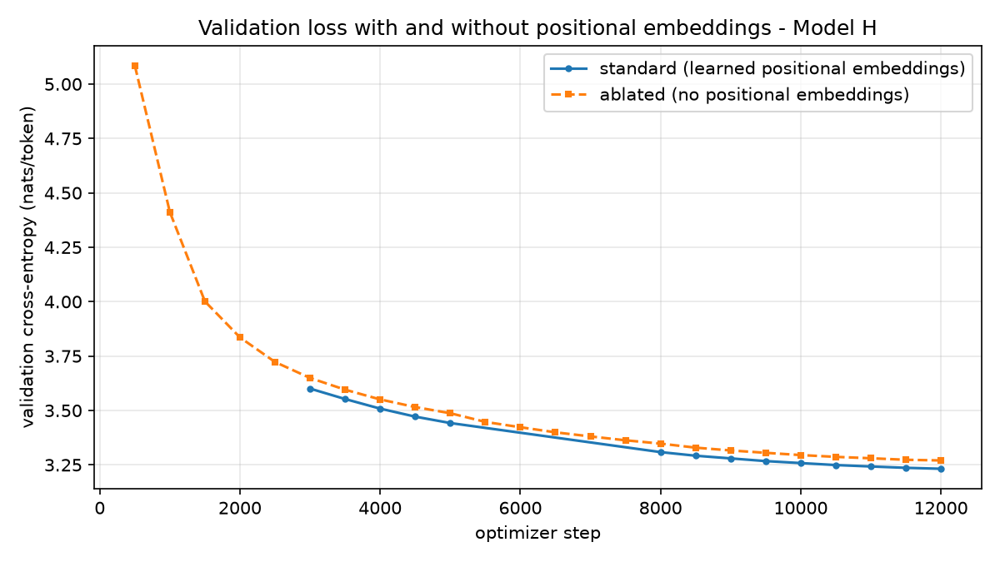
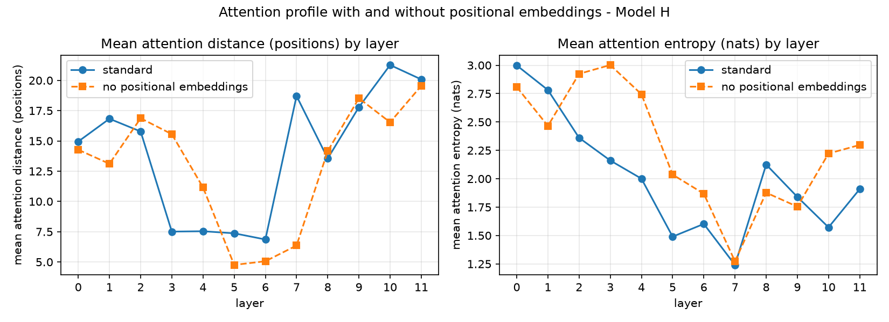
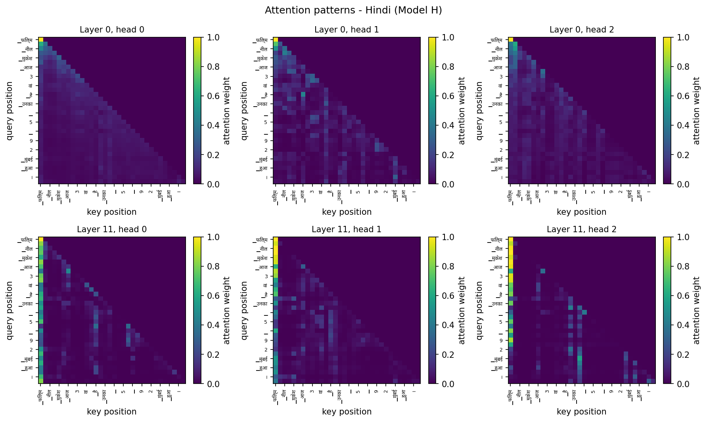
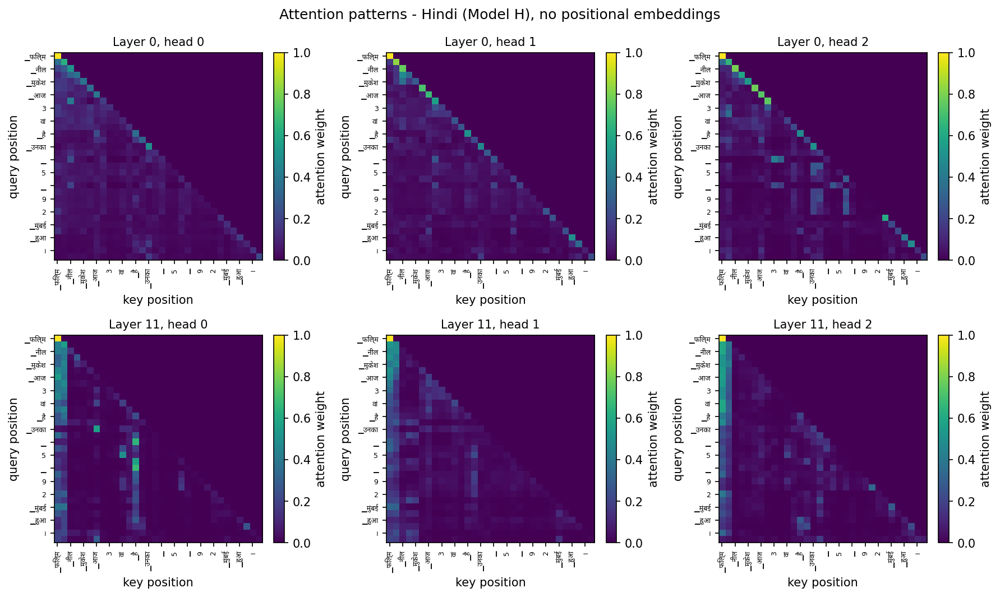
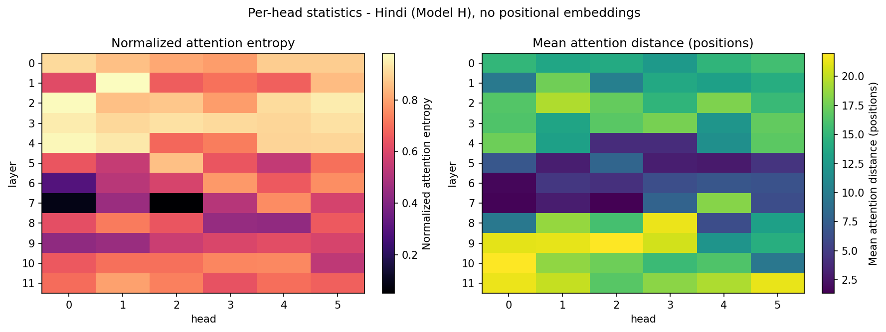

# Bonus ablation - Model H (Hindi) without positional embeddings

**Language Models and Agents, Monsoon 2026 - Individual Project**

## 1. Setup

The Hindi model was pretrained a second time with the positional-embedding
table removed (`ModelConfig(use_positional_embeddings=False)`) and then put through the
full Phase 2 evaluation suite, on the same held-out text, prompts, decoding settings and
attention sample as the standard model.

| | Standard | No positional embeddings |
|---|---:|---:|
| Trainable parameters | 24,562,944 | 24,366,336 |
| Optimizer steps | 12,000 | 12,000 |
| Tokens seen | 590,000,000 | 589,824,000 |
| Best validation loss | 3.2320 | 3.2703 |

Model-configuration differences: `use_positional_embeddings`.
Training-configuration differences: `amp`, `beta1`, `beta2`, `checkpoint_interval`, `compile`, `eval_batches`, `eval_interval`, `log_interval`.

## 2. Validation loss at matched steps

| Step | Standard | No positional embeddings | Difference |
|---:|---:|---:|---:|
| 3,000 | 3.6004 | 3.6493 | +0.0489 |
| 4,000 | 3.5084 | 3.5507 | +0.0423 |
| 5,000 | 3.4422 | 3.4873 | +0.0451 |
| 8,500 | 3.2920 | 3.3291 | +0.0371 |
| 9,500 | 3.2673 | 3.3053 | +0.0380 |
| 10,500 | 3.2491 | 3.2867 | +0.0376 |
| 11,500 | 3.2364 | 3.2733 | +0.0369 |
| 12,000 | 3.2320 | 3.2703 | +0.0383 |

## 3. Language-modeling metrics

| Metric | Standard | No positional embeddings |
|---|---:|---:|
| Cross-entropy (nats/token) | 3.2152 | 3.2515 |
| Perplexity | 24.91 | 25.83 |
| Bits-per-byte | 0.5173 | 0.5231 |
| Held-out tokens | 1,638,400 | 1,638,400 |

## 4. Generation quality

Each cell reads standard → no positional embeddings.

| Decoding | chrF | ROUGE-L | BLEU-4 | Repetition | Distinct-2 |
|---|---|---|---|---|---|
| Greedy | 13.57 → 12.44 | 10.27 → 9.08 | 1.07 → 1.10 | 0.563 → 0.615 | 0.288 → 0.271 |
| T = 0.5 | 16.30 → 15.84 | 11.07 → 10.45 | 1.20 → 0.92 | 0.208 → 0.234 | 0.573 → 0.558 |
| T = 1.0 | 18.71 → 18.94 | 9.82 → 9.89 | 0.76 → 0.59 | 0.002 → 0.001 | 0.910 → 0.909 |
| T = 1.5 | 17.81 → 17.80 | 5.66 → 5.63 | 0.28 → 0.36 | 0.000 → 0.000 | 0.990 → 0.989 |

*Greedy, standard:*

> 1990 में मुंबई में एक फिल्म निर्देशक के रूप में काम कर रहे थे। उन्होंने 1990 में फिल्म 'दंगल' से बॉलीवुड में कदम रखा था। उन्होंने 1990 में फिल्म 'दंगल' से बॉलीवुड में कदम रखा था।

*Greedy, no positional embeddings:*

> 1992 में मुंबई के एक अस्पताल में भर्ती हुए थे। वह 1992 में मुंबई के एक अस्पताल में भर्ती हुए थे। वह 1992 में मुंबई के एक अस्पताल में भर्ती हुए थे। वह 1993 में मुंबई के एक अस्पताल में भर्ती हुए थे। वह

*T = 1.0, standard:*

> बॉलीवुड में पहली बार मुख्य अभिनेता के रूप में दिखाई दिए थे। उनके पिता की दोस्ती सतलुज पहाड़ी और भारतीय / अगम ऑफ सी प्रीमियम फिल्म थी। उनकी दोस्त सुदर्शन अपनी पत्नी के साथ शादी के लिए तैयार थे।

*T = 1.0, no positional embeddings:*

> मुंबई में बतौर एक्टर शुरुआत करेगा, जहां वह फेमस एक्टर अभिनेता प्यार से भक्ति रखते हैं। उनके रोमांटिक रोल की बात करें तो उनकी अभिनेत्री राधा कृष्ण को कोई आवाज नहीं पसंद आ रही है। NDTV में, फिल्म निर्देशक वाड्रा गांगुली ने फिल्म से ब्रेकअप किया था, लेकिन पिछले साल

## 5. Attention

| Layer | Distance, standard | Distance, ablated | Entropy, standard | Entropy, ablated |
|---:|---:|---:|---:|---:|
| 0 | 14.95 | 14.27 | 2.999 | 2.809 |
| 1 | 16.83 | 13.11 | 2.782 | 2.465 |
| 2 | 15.78 | 16.87 | 2.361 | 2.924 |
| 3 | 7.51 | 15.56 | 2.161 | 3.002 |
| 4 | 7.54 | 11.16 | 2.001 | 2.745 |
| 5 | 7.37 | 4.76 | 1.490 | 2.037 |
| 6 | 6.86 | 5.06 | 1.602 | 1.868 |
| 7 | 18.71 | 6.36 | 1.241 | 1.273 |
| 8 | 13.55 | 14.16 | 2.125 | 1.877 |
| 9 | 17.79 | 18.52 | 1.840 | 1.754 |
| 10 | 21.27 | 16.54 | 1.572 | 2.222 |
| 11 | 20.08 | 19.55 | 1.909 | 2.298 |

| Head type | Standard | No positional embeddings |
|---|---:|---:|
| Local | 10 | 12 |
| Long-range | 48 | 37 |
| Diffuse | 14 | 23 |

## 6. What breaks without position information

**Language modeling.** Removing the positional table changed test perplexity from 24.91 to 25.83 (×1.04) and bits-per-byte from 0.5173 to 0.5231: a modest cost.

**What removing the table does and does not remove.** Attention with no positional signal is order-blind only one
layer at a time: a single layer sees the tokens before each position as an unordered set.
Under the causal mask, though, every position's state summarizes a prefix of a different
length, so a second layer can recover order - `scripts/test_reasoning.py` verifies both
halves of that on small models. What the ablation measures is how much of the positional
signal a 12-layer stack reconstructs for itself, and at what price.

**Over training,** the validation-loss gap narrowed from +0.0489 nats at step 3,000 to +0.0383 at step 12,000 - the stack keeps recovering order it was not given.

**Attention.** Layer 0 is where the loss of position should show first, because it is the
only layer with no earlier layer to reconstruct order from. There, mean attention distance
went from 14.95 to 14.27 positions and entropy from 2.999 to 2.809; across
all heads, local heads went from 10 to 12 and long-range heads from 48 to 37.

**Generation.** Greedy repetition went from 0.563 to 0.615, and chrF at T = 1.0 from 18.71 to 18.94.

**Caveat.** One run with and one without positional embeddings: differences of the size
that ordinary run-to-run variation produces should not be read as effects of the ablation.
