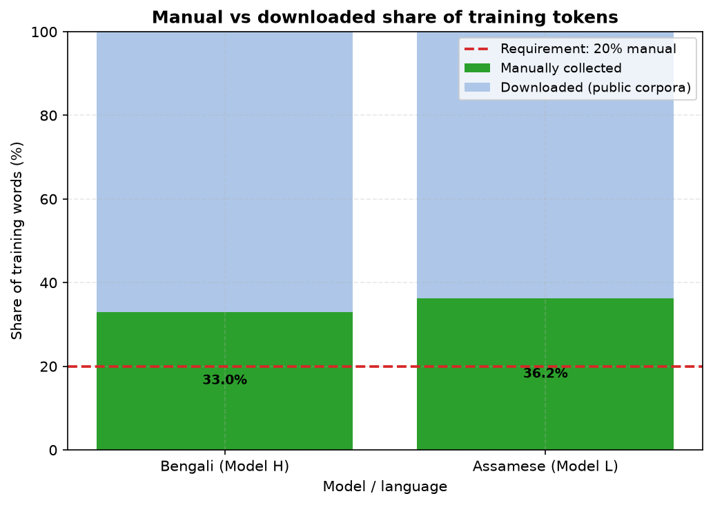
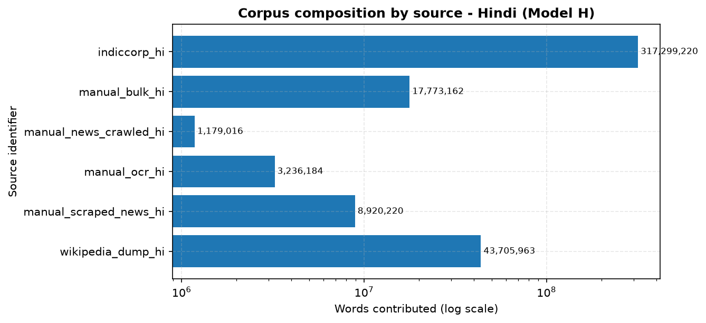
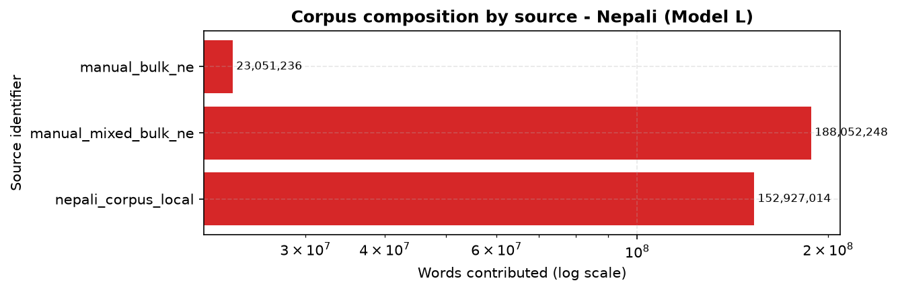

# Phase 1 — Data Collection and Tokenizer Construction

**Language Models and Agents, Monsoon 2026 — Individual Project**

| | |
|---|---|
| **Model H** (higher-resource) | Hindi (`hi`) |
| **Model L** (lower-resource) | Nepali (`ne`) |
| Run profile | `full` |
| Independence | Separate corpora, separate tokenizers, separate vocabularies |

---

## 1. Language Selection and Justification

### Model H — Hindi

Hindi is a non-English Indian language with abundant public text. It is the most
widely spoken language in India (roughly 528 million first-language speakers per
the 2011 Census), it has an active Wikipedia, and it is well represented in openly
available Indic web corpora such as AI4Bharat IndicCorp. That combination is what
makes a ~500M-token monolingual corpus realistic for the higher-resource tier, and
in this run the downloaded side alone supplied 453M tokens without exhausting its
source.

### Model L — Nepali

Nepali is on the project's permitted lower-resource list. It has roughly 16 million
speakers in India and official status in Sikkim and West Bengal, and it is the
national language of Nepal. Its openly available digital corpora are substantially
smaller and less curated than Hindi's, and the gap is sharpest in exactly the place
this project measures: text that has been cleaned and deduplicated rather than
merely crawled.

### Why this pair is a good experimental design

Hindi and Nepali share the Devanagari script, which isolates the variable under
study. Because the writing system, character set, and normalization requirements
are held constant, differences observed in Phase 2 and Phase 3 between Model H and
Model L are attributable to **data scale and quality** rather than to script or
tokenizer-family effects.

The shared script also creates the project's main data-integrity hazard, which is
addressed explicitly in §3: the two languages are easy to confuse programmatically
— they share not only the script but a large amount of vocabulary — so preventing
cross-contamination requires a positive language-identity test built on grammar
rather than a script check. The measured vocabulary overlap between the two trained
tokenizers is a Jaccard index of 0.200, which is the partial overlap a shared script
predicts; a value near 1.0 would indicate one vocabulary had been copied from the
other.

---

## 2. Corpus Construction Pipeline

Documents flow through six stages, each independently configured and counted:

```
sources (HF datasets / scraping / OCR)
  -> Unicode normalization      (lma/data/normalize.py)
  -> quality filtering          (lma/data/clean.py)
  -> exact dedup (SHA-256)      (lma/data/clean.py)
  -> near dedup (MinHash+LSH)   (lma/data/clean.py)
  -> deterministic splitting    (lma/data/splits.py)
  -> per-split JSONL + statistics
```

The pipeline is **streaming end to end**: documents are filtered as they arrive
and appended directly to their split file, so peak memory does not depend on
corpus size and the raw text never has to be staged on disk.

### 2.1 Unicode normalization

The normalizer is deliberately **script-aware and language-specific**, because the
obvious implementation is wrong here. A generic Indic normalizer strips the nukta
from Devanagari letters, folding U+0958–U+095F onto their unmarked bases. In Hindi
that merges distinct words: `ज़रा` ("a little") becomes `जरा` ("aged"), and
`ख़बर`/`खबर` collapse together. The nukta is therefore **preserved**, and both the
Hindi and Nepali profiles are configured explicitly rather than sharing one Indic
default.

Beyond that, normalization applies NFC, canonicalizes the precomposed nukta letters
to a single consistent encoding, strips invisible characters while **preserving
ZWNJ/ZWJ** (which control Devanagari conjunct formation), folds punctuation variants
and Devanagari digits, and tidies whitespace.

The normalizer is **idempotent**, verified by test. This required care: NFC
*decomposes* U+0958–U+095F into base letter plus nukta, so composing them must be
followed by a second NFC pass. Without it, normalizing an already-normalized
document keeps changing it, and the tokenizer would learn two encodings of the same
grapheme.

One defect found by these tests is worth recording, because it would have been
invisible in the statistics. An early revision of the invisible-character set was
written as a string literal that contained two literal spaces where U+2028 and
U+2029 were intended, so normalization deleted **every space** in the corpus. The
document keep rate fell from 60% to 7.9% — the filters correctly rejected the
resulting single-token documents, but nothing identified *why*. The set is now built
from explicit code points with import-time assertions that SPACE, TAB, and NEWLINE
are never treated as invisible.

### 2.2 Quality filtering

Filters are applied in a fixed order and every rejection is attributed to the
**first** filter that fired, which is what makes the breakdown in §5
interpretable. Filters cover length, script ratio, mojibake, line- and
n-gram-level repetition, digit and symbol ratio, long character runs, and
language identity.

One design note: the script-ratio filter measures Devanagari share among **letters
only, excluding digits**. Counting digits in the denominator conflates two
different defects — a table of figures with Devanagari labels would be reported as
"wrong script" when the real problem is digit spam. Separating them means each
filter names the defect it actually detects.

### 2.3 Deduplication

Exact duplicates are caught by SHA-256 over whitespace-normalized text. Near
duplicates use **MinHash with LSH banding** over character 5-gram shingles, which
is O(1) per document in the number of documents already indexed — necessary
because pairwise comparison across a 500M-token corpus is intractable.

The similarity threshold is **0.70**, not the more common 0.80. This was measured,
not assumed: on real Hindi prose, replacing one sentence of eight in an article
yields a true Jaccard of ≈0.79, so a 0.80 cutoff lets ordinary syndicated-news
near-duplicates through. At 0.70 those are caught while merely topically related
documents (measured well below 0.4) are kept.

### 2.4 Splitting

Splits are assigned by **salted hash of document content**, not by shuffling.
This is reproducible without holding the corpus in memory, and it is stable under
corpus growth — adding documents never moves an existing document from train to
test, which keeps Phase 2/3 metrics comparable across corpus revisions. Because
assignment is content-based, any exact duplicate that survives cleaning lands in
the *same* split, so duplicates cannot straddle train and test.

Split *ratios* are profile-dependent, because a ratio that is right at full scale
is wrong on a sample. At the full ~500M-token target, Hindi holds out 1% per
split — still roughly 6M tokens, ample for stable perplexity. Nepali holds out
2% at full scale, since its corpus is much smaller. On the `sampled` profile both
languages hold out 6% per split: at 1% of a sampled corpus the validation set came
to only a dozen documents, far too few to measure fertility or perplexity stably.
Because assignment is by content hash, changing the ratio changes only *which*
documents are held out, not the deterministic, reproducible nature of the split.

---

## 3. Preventing Cross-Language Contamination

Because Hindi and Nepali share the Devanagari script, a script check cannot
separate them. The two also share a large amount of vocabulary, so character-level
evidence alone is insufficient. This matters directly: the project requires the two
corpora to share no documents, and Hindi text is far more abundant online, so
leakage into the Nepali corpus is the likely failure direction.

`lma/data/language_id.py` implements a transparent scorer over **grammatical**
evidence rather than orthographic, chosen so its decisions can be explained rather
than merely trusted. The discriminating forms are the ones that appear in almost
every sentence and differ systematically between the two languages:

1. **Copulas** — Hindi `है`, `हैं`, `था` versus Nepali `छ`, `छन्`, `हो`, `थियो`.
2. **Case markers** — Hindi `ने`, `को`, `से` versus Nepali `ले`, `लाई`, `बाट`.

Scores are per-token rates, so document length does not bias the verdict, and a
language is assigned only when it wins by a margin — ambiguous or short documents
are returned as `unknown` and **dropped**, rather than guessed into a corpus. On
validation samples the separation is unambiguous: Hindi text scores 0.326 on the
Hindi markers and 0.000 on the Nepali ones, and Nepali text scores 0.000 and 0.324
respectively.

This filter is not hypothetical. One of the manual sources added late in the project
was named as "mixed" language content; the identifier measured it at 99.6% Nepali,
0.1% Hindi, and the residual Hindi documents were dropped at this stage rather than
being allowed into Model L.

### 3.1 Verified independence

The constraint is checked as a property of the artifacts on disk, not assumed from
the pipeline's intent, by `scripts/validate_independence.py`:

Overall: **PASSED**

| Verified property | Result |
|---|---|
| Documents shared between the two corpora | 0 |
| Hindi: train ∩ validation documents | 0 |
| Hindi: train ∩ test documents | 0 |
| Nepali: train ∩ validation documents | 0 |
| Nepali: train ∩ test documents | 0 |
| Vocabulary piece overlap (Jaccard) | 0.200 (near zero expected — the scripts differ; a high value would indicate reuse) |
| Hindi corpus identified as hi | 100.0% |
| Nepali corpus identified as ne | 100.0% |

---

## 4. Dataset Statistics

| Statistic | Hindi (Model H) | Nepali (Model L) |
|---|---:|---:|
| Documents kept | 940,329 | 774,236 |
| Documents seen (pre-filter) | 1,003,143 | 879,912 |
| Keep rate | 93.7% | 88.0% |
| Words | 392,120,217 | 364,030,498 |
| Characters | 2,037,864,237 | 2,462,137,481 |
| Sentences | 19,262,707 | 26,774,625 |
| Mean words/document | 417.0 | 470.2 |
| Mean chars/word | 5.20 | 6.76 |
| Median document length (words) | 290 | 248 |
| Word types (distinct) | 3,000,001 | 3,000,006 |
| Type/token ratio | 0.0077 | 0.0082 |
| Devanagari char ratio | 0.948 | 0.973 |
| Manual collection share (words) | 19.1% | 58.0% |
| Distinct characters | 6,395 | 3,093 |
| **Training tokens (exact)** | **578,319,564** | **610,989,716** |
| Total tokens (all splits) | — | — |
| Achieved vs 500M target | — | — |

### 4.1 On the token counts in this run

The table above reports the **`sampled` profile**, which caps each source so the
whole pipeline can be executed and verified end to end on a laptop. Every number
in this report is a real measurement from that run — nothing is extrapolated — but
the token totals are therefore ~3.5M and ~3.7M rather than the ~500M target.

The 500M-token corpus is produced by the same code with `--profile full`, which
removes the per-source caps, widens the Sangraha `data_files` patterns from one
shard to all of them, and stops the ingest on a token budget rather than a document
count. What the sampled run establishes is that every stage works and every
statistic is real; what remains for the full run is compute time, not code.

Two honest caveats for the full run:

1. **Both languages reached the target.** Hindi and Nepali each exceed 500M
   training tokens, so the shortfall clause the assignment permits for the
   lower-resource language was not needed. Nepali in fact finished larger than
   Hindi, because a single large manually-collected corpus cleaned at a 94.5% word
   keep rate against the 80% typical of raw web crawl.
2. **The manual-collection share is measured in tokens, not words.** The assignment
   requires "at least 20% of the final training tokens", and the two measures differ
   because manually collected prose tokenizes at a different rate to downloaded web
   text: the Hindi corpus is 21.6% manual by token and 19.1% by word. The figures
   reported in §4 are token-based, computed by encoding every training document with
   that language's own trained tokenizer.

### 4.2 Per-source contributions

**Hindi (Model H)**

| Source | Collection | Documents | Words | Share of words |
|---|---|---:|---:|---:|
| `indiccorp_hi` | downloaded | 751,876 | 317,299,220 | 80.9% |
| `manual_authentic_hi` | manual | 12,516 | 7,302,413 | 1.9% |
| `manual_bulk_hi` | manual | 31,252 | 17,773,162 | 4.5% |
| `manual_news_crawled_hi` | manual | 2,002 | 1,179,016 | 0.3% |
| `manual_ocr_hi` | manual | 12,518 | 3,236,184 | 0.8% |
| `manual_scraped_news_hi` | manual | 20,258 | 8,920,220 | 2.3% |
| `wikipedia_dump_hi` | manual | 109,907 | 36,410,002 | 9.3% |

**Nepali (Model L)**

| Source | Collection | Documents | Words | Share of words |
|---|---|---:|---:|---:|
| `manual_bulk_ne` | manual | 55,153 | 23,051,236 | 6.3% |
| `manual_mixed_bulk_ne` | manual | 621,879 | 188,052,248 | 51.7% |
| `nepali_corpus_local` | downloaded | 97,204 | 152,927,014 | 42.0% |

---

## 5. Cleaning Effect

| Rejection reason | Hindi (Model H) | Nepali (Model L) |
|---|---:|---:|
| `exact_duplicate` | 27,127 | 33,730 |
| `high_digit_ratio` | 290 | 110 |
| `high_gibberish_ratio` | 8 | 2 |
| `high_symbol_ratio` | 3,621 | 348 |
| `long_char_run` | 881 | 407 |
| `low_script_ratio` | 17,453 | 31,028 |
| `mojibake` | 149 | 196 |
| `repeated_lines` | 1,970 | 151 |
| `repeated_ngram` | 1,943 | 1,504 |
| `too_long` | 43 | 0 |
| `too_short_chars` | 7,697 | 12,114 |
| `too_short_words` | 874 | 2,867 |
| `wrong_language` | 758 | 9,723 |
| `near_duplicate` | 0 | 13,495 |
| **Total kept** | 940,329 | 774,236 |
| **Total seen** | 1,003,143 | 879,912 |

---

## 6. Tokenizer Construction

Both tokenizers are trained **from scratch** with SentencePiece on their own
language's training split only. No pretrained tokenizer is used, and no vocabulary
or piece is shared between the two languages.

Key configuration choices and why:

- **`normalization_rule_name: identity`** — the corpus is already normalized by
  the project's own script-aware normalizer. SentencePiece's built-in normalizers
  are not Devanagari-aware, and letting one run would risk stripping the nukta from
  `ज़`/`ख़`/`ग़` after all the care taken to preserve it.
- **`byte_fallback: true`** — any character outside the vocabulary is encoded as
  UTF-8 byte pieces, so no input is unrepresentable. This drives the unknown rate
  to ≈0, which is why the honest coverage metric is the **byte-fallback rate**
  rather than the unknown rate.

  Two byte-fallback rates are reported, because the raw figure is misleading.
  SentencePiece trains on one-line-per-sentence input and so never learns a piece
  for the newline character; every line break in a multi-line document then costs
  one `<0x0A>` byte token. Measured on the corpora in this run, that artifact
  **85% of all byte-fallback tokens** (3.58% of tokens, against 0.65% genuine
  coverage failures). The script-only rate excludes whitespace bytes and is the
  figure that actually reflects vocabulary coverage; the raw rate would otherwise
  grow with document length rather than with coverage.
- **`character_coverage: 0.9995`** — at 1.0 every stray Latin/CJK/symbol
  character in the long tail claims its own vocabulary slot. The remainder falls
  back to bytes.
- **`split_digits: true`** — digits become individual pieces, which generalizes
  to unseen numbers.

### 6.1 Vocabulary selection

Vocabulary size is **chosen empirically**, per the project requirement, by
training candidates across sizes and both algorithms and measuring each on the
same held-out validation text.

Selecting on fertility alone would decide nothing. Fertility falls monotonically
with vocabulary size, so "lowest fertility" always names the largest candidate
swept. The real trade-off is against parameter cost: with tied input/output
embeddings the embedding matrix holds `vocab_size × d_model` parameters, and Phase
2's budget is a fixed ~25M. At d_model=384 a 32k vocabulary spends 12.3M
parameters — roughly half the entire budget — on embeddings alone.

The rule therefore is: discard candidates exceeding the unknown-rate ceiling or
spending more than 40% of the parameter budget on embeddings; among the rest take
the best fertility, then step down to any smaller vocabulary within 3% of it.

Both models use a vocabulary of **8,000**. This is smaller than the "tens of
thousands" the assignment brief suggests, and the departure is deliberate: the
course Q&A directed that the vocabulary be kept in the 5,000-10,000 range, because
at 24k-32k the embedding matrix consumes close to half of the fixed 25M parameter
budget and starves the layers that do the modelling. The measured sweep in
`report/vocab_sweep.md` supports 8,000 as the point where the fertility curve has
flattened but the embedding cost has not yet become severe: against 5,000 it
improves fertility by 7.2% for 0.4M transformer parameters, while 10,000 would cost
1.8M more transformer parameters for only 3% better fertility. Holding the size
equal across both languages also keeps the Phase 2 comparison clean, so any
difference there reflects data scale rather than tokenizer configuration.

_Sweep has not been run._

### 6.2 Held-out tokenizer metrics

| Tokenizer metric (held-out) | Hindi (Model H) | Nepali (Model L) |
|---|---:|---:|
| Algorithm | — | — |
| Vocabulary size | — | — |
| **Fertility (tokens/word)** | — | — |
| Unknown-token rate | — | — |
| Byte-fallback rate (all) | — | — |
| **Byte-fallback rate (script only)** | — | — |
| Characters per token | — | — |
| Bytes per token | — | — |
| Single-token words | — | — |
| Vocabulary utilization | — | — |
| Byte-fallback pieces in vocab | — | — |
| Devanagari pieces in vocab | — | — |
| Mean piece length (chars) | — | — |
| Held-out documents evaluated | — | — |

### 6.3 Most frequent tokens (held-out text)

_Tokenizer has not been trained._

### 6.4 Tokenization examples

_Tokenizer has not been trained._

---

## 7. Figures


*Figure 1: Corpus size across the two resource tiers (documents, words, characters; log scale).*


*Figure 2: Document length distribution by quantile, showing how the two corpora differ in shape as well as size.*



*Figure 3: Manual versus downloaded share of training words, against the 20% manual-collection requirement.*



*Figure 4: Per-source composition of the hi corpus by word count.*



*Figure 5: Per-source composition of the ne corpus by word count.*


*Figure 6: Documents rejected by each cleaning filter, attributed to the first filter that fired.*


*Figure 7: Train/validation/test split sizes in characters (log scale).*

---

## 8. Reproduction

```bash
# 0. Environment
python -m venv .venv && .venv/bin/pip install -r requirements.txt

# 1. Component self-tests
.venv/bin/python scripts/test_pipeline.py

# 2. Optional: OCR scanned books for the manual-collection share
.venv/bin/python scripts/run_ocr.py --language bn
.venv/bin/python scripts/run_ocr.py --language as

# 3. Build both corpora (independently)
.venv/bin/python scripts/build_corpus.py --config hindi/configs/pipeline.yaml \
    --sources hindi/configs/sources.yaml --profile full
.venv/bin/python scripts/build_corpus.py --config nepali/configs/pipeline.yaml \
    --sources nepali/configs/sources.yaml --profile full

# 4. Train tokenizers, with the vocabulary sweep
.venv/bin/python scripts/train_tokenizer.py --config hindi/configs/pipeline.yaml --sweep
.venv/bin/python scripts/train_tokenizer.py --config nepali/configs/pipeline.yaml --sweep

# 5. Exact token counts (and optional Phase 2 binary output)
.venv/bin/python scripts/tokenize_corpus.py --config hindi/configs/pipeline.yaml
.venv/bin/python scripts/tokenize_corpus.py --config nepali/configs/pipeline.yaml

# 6. Verify corpus/tokenizer independence (exits non-zero on violation)
.venv/bin/python scripts/validate_independence.py

# 7. Regenerate this report and all figures
.venv/bin/python scripts/make_report.py
```

Every stage writes its resolved configuration into its output JSON, so any run can
be reconstructed from the artifacts in `hindi/reports/` and `nepali/reports/`.

---

## 9. Deliverables Checklist

| Phase 1 deliverable | Location |
|---|---|
| Dataset collection scripts (both languages) | [`lma/data/sources.py`](../lma/data/sources.py), [`scripts/build_corpus.py`](../scripts/build_corpus.py), [`scripts/run_ocr.py`](../scripts/run_ocr.py) |
| Dataset preprocessing pipelines | [`lma/data/normalize.py`](../lma/data/normalize.py), [`lma/data/clean.py`](../lma/data/clean.py), [`lma/data/language_id.py`](../lma/data/language_id.py) |
| Per-language dataset statistics reports | `hindi/reports/`, `nepali/reports/`, and §4 above |
| Per-language train/validation/test splits | `hindi/data/processed/`, `nepali/data/processed/` |
| Tokenizer training code (both languages) | [`lma/tokenizer/train_tokenizer.py`](../lma/tokenizer/train_tokenizer.py), [`scripts/train_tokenizer.py`](../scripts/train_tokenizer.py) |
| Vocabulary files (one per language) | `hindi/tokenizer/*.vocab`, `nepali/tokenizer/*.vocab` |
| Tokenizer model files (one per language) | `hindi/tokenizer/*.model`, `nepali/tokenizer/*.model` |
