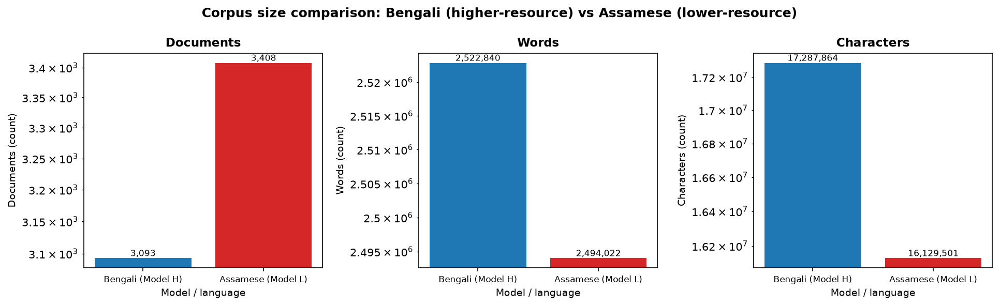
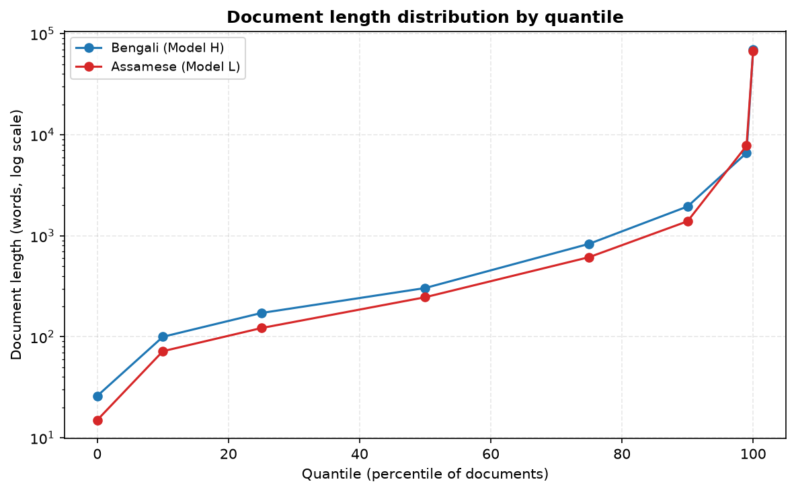
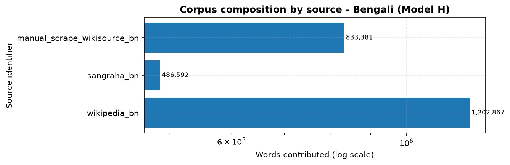
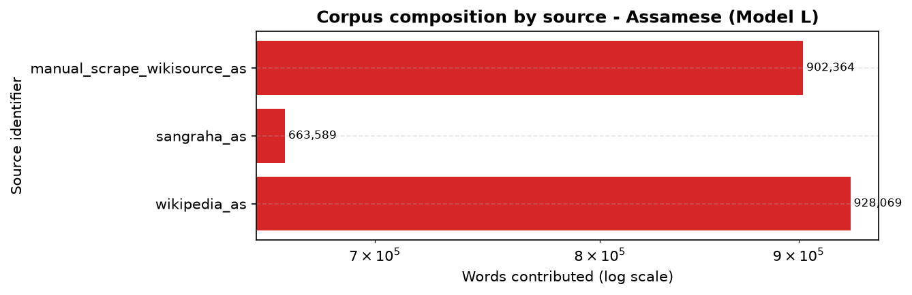
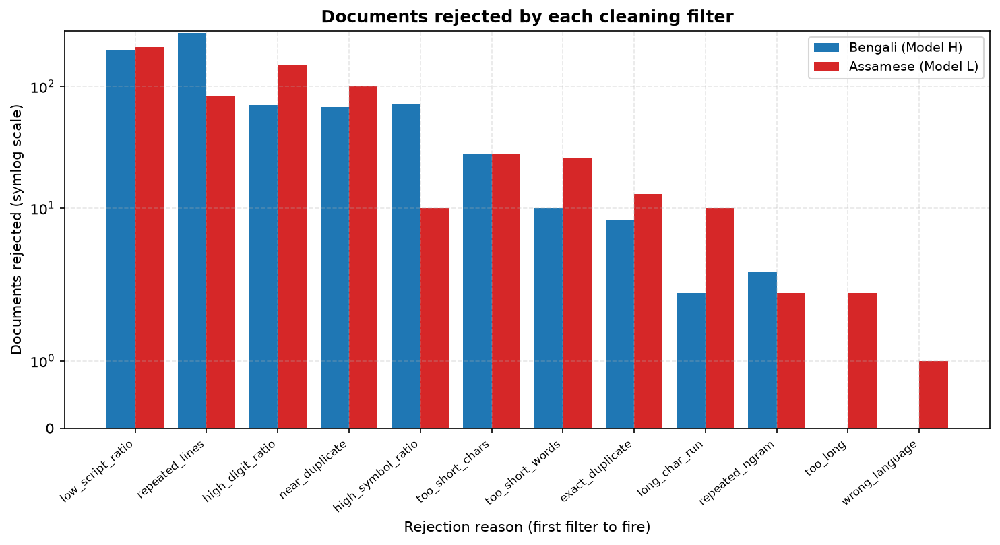
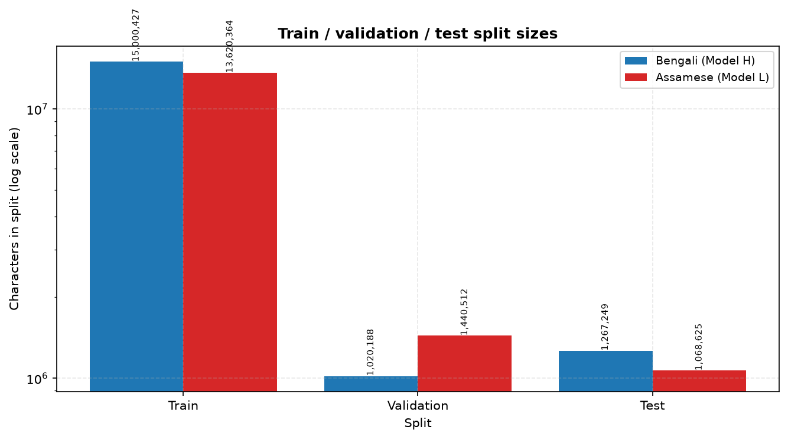
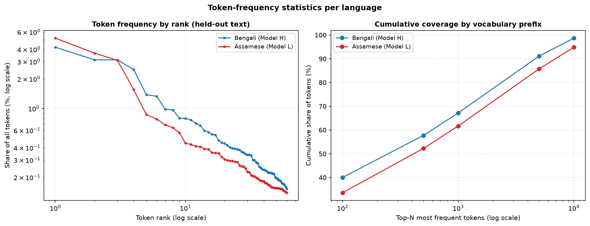
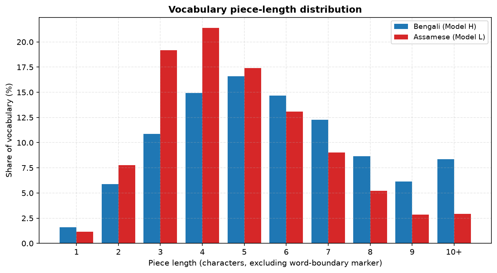

# Phase 1 — Data Collection and Tokenizer Construction

**Language Models and Agents, Monsoon 2026 — Individual Project**

| | |
|---|---|
| **Model H** (higher-resource) | Bengali (`bn`) |
| **Model L** (lower-resource) | Assamese (`as`) |
| Run profile | `sampled` |
| Independence | Separate corpora, separate tokenizers, separate vocabularies |

---

## 1. Language Selection and Justification

### Model H — Bengali

Bengali is a non-English Indian language with substantial public text. It is the
second most-spoken language in India (roughly 97 million first-language speakers
per the 2011 Census, and about 237 million worldwide), it has an active Wikipedia,
and it is well represented in openly available Indic web corpora such as AI4Bharat
Sangraha. That combination is what makes a ~500M-token monolingual corpus
realistic for the higher-resource tier.

### Model L — Assamese

Assamese is on the project's permitted lower-resource list. It has roughly 15
million speakers and official status in Assam, yet its openly available digital
corpora are one to two orders of magnitude smaller than Bengali's. That gap is the
point: it produces a genuine resource-tier contrast rather than two comfortable
corpora of similar size.

### Why this pair is a good experimental design

Bengali and Assamese share the Bengali-Assamese script, which isolates the
variable under study. Because the writing system, character set, and
normalization requirements are held constant, differences observed in Phase 2 and
Phase 3 between Model H and Model L are attributable to **data scale and quality**
rather than to script or tokenizer-family effects.

The shared script also creates the project's main data-integrity hazard, which is
addressed explicitly in §3: the two languages are easy to confuse
programmatically, so preventing cross-contamination requires a positive
language-identity test rather than a script check.

---

## 2. Corpus Construction Pipeline

Documents flow through six stages, each independently configured and counted:

```
sources (HF datasets / scraping / OCR)
  -> Unicode normalization      (lma/data/normalize.py)
  -> quality filtering          (lma/data/clean.py)
  -> exact dedup (SHA-256)      (lma/data/clean.py)
  -> near dedup (MinHash+LSH)   (lma/data/clean.py)
  -> deterministic splitting    (lma/data/splits.py)
  -> per-split JSONL + statistics
```

The pipeline is **streaming end to end**: documents are filtered as they arrive
and appended directly to their split file, so peak memory does not depend on
corpus size and the raw text never has to be staged on disk.

### 2.1 Unicode normalization

The normalizer is deliberately **script-aware and language-specific**, because the
obvious implementation is wrong here. A generic Indic normalizer folds
U+09F0 (`ৰ`) into U+09B0 (`র`), which silently rewrites Assamese as Bengali and
destroys the very distinction this project studies. Instead:

- The **Assamese** profile preserves U+09F0 (`ৰ`) and U+09F1 (`ৱ`).
- The **Bengali** profile folds them to `র`/`ব`, since in a Bengali corpus their
  presence indicates OCR noise or mis-tagged text.

Beyond that, normalization applies NFC, unifies the two-part vowel signs
(`U+09C7 + U+09BE` → `U+09CB`) and the nukta letters, strips invisible characters
while **preserving ZWNJ/ZWJ** (which control Indic conjunct formation), folds
punctuation variants and Bengali digits, and tidies whitespace.

The normalizer is **idempotent**, verified by test. This required care: NFC
*decomposes* U+09DC/U+09DD/U+09DF into base letter plus nukta, so composing them
must be followed by a second NFC pass. Without it, normalizing an
already-normalized document keeps changing it, and the tokenizer would learn two
encodings of the same grapheme.

### 2.2 Quality filtering

Filters are applied in a fixed order and every rejection is attributed to the
**first** filter that fired, which is what makes the breakdown in §5
interpretable. Filters cover length, script ratio, mojibake, line- and
n-gram-level repetition, digit and symbol ratio, long character runs, and
language identity.

One design note: the script-ratio filter measures Bengali share among **letters
only, excluding digits**. Counting digits in the denominator conflates two
different defects — a table of figures with Bengali labels would be reported as
"wrong script" when the real problem is digit spam. Separating them means each
filter names the defect it actually detects.

### 2.3 Deduplication

Exact duplicates are caught by SHA-256 over whitespace-normalized text. Near
duplicates use **MinHash with LSH banding** over character 5-gram shingles, which
is O(1) per document in the number of documents already indexed — necessary
because pairwise comparison across a 500M-token corpus is intractable.

The similarity threshold is **0.70**, not the more common 0.80. This was measured,
not assumed: on real Bengali prose, replacing one sentence of eight in an article
yields a true Jaccard of ≈0.79, so a 0.80 cutoff lets ordinary syndicated-news
near-duplicates through. At 0.70 those are caught while merely topically related
documents (measured well below 0.4) are kept.

### 2.4 Splitting

Splits are assigned by **salted hash of document content**, not by shuffling.
This is reproducible without holding the corpus in memory, and it is stable under
corpus growth — adding documents never moves an existing document from train to
test, which keeps Phase 2/3 metrics comparable across corpus revisions. Because
assignment is content-based, any exact duplicate that survives cleaning lands in
the *same* split, so duplicates cannot straddle train and test.

Split *ratios* are profile-dependent, because a ratio that is right at full scale
is wrong on a sample. At the full ~500M-token target, Bengali holds out 1% per
split — still roughly 5M tokens, ample for stable perplexity. Assamese holds out
2% at full scale, since its corpus is much smaller. On the `sampled` profile both
languages hold out 6% per split: at 1% of a sampled corpus the validation set came
to only a dozen documents, far too few to measure fertility or perplexity stably.
Because assignment is by content hash, changing the ratio changes only *which*
documents are held out, not the deterministic, reproducible nature of the split.

---

## 3. Preventing Cross-Language Contamination

Because Bengali and Assamese share a script, a script check cannot separate them,
and general-purpose language identifiers routinely label Assamese as Bengali. This
matters directly: the project requires the two corpora to share no documents, and
Bengali text is far more abundant online, so leakage into the Assamese corpus is
the likely failure direction.

`lma/data/language_id.py` implements a transparent scorer over two kinds of
orthographic evidence, chosen so its decisions can be explained rather than
merely trusted:

1. **Exclusive letters** — `ৰ`/`ৱ` appear in Assamese and essentially never in
   correct Bengali; the ratio of `ৰ` to `র` is strongly diagnostic.
2. **Function words** — high-frequency grammatical forms differ between the
   languages (Assamese `আৰু`, `হৈছে`, `কৰি` versus Bengali `এবং`, `হয়েছে`, `করে`).

Scores are per-token rates, so document length does not bias the verdict, and a
language is assigned only when it wins by a margin — ambiguous or short documents
are returned as `unknown` and **dropped**, rather than guessed into a corpus.

This filter is not hypothetical. Spot-checking the Sangraha `verified/asm` split
during development turned up Latin-script documents from an unrelated language;
those are removed by this stage.

### 3.1 Verified independence

The constraint is checked as a property of the artifacts on disk, not assumed from
the pipeline's intent, by `scripts/validate_independence.py`:

Overall: **PASSED**

| Verified property | Result |
|---|---|
| Documents shared between the two corpora | 0 |
| Bengali: train ∩ validation documents | 0 |
| Bengali: train ∩ test documents | 0 |
| Assamese: train ∩ validation documents | 0 |
| Assamese: train ∩ test documents | 0 |
| Vocabulary piece overlap (Jaccard) | 0.140 (overlap expected — shared script; ≈1.0 would indicate reuse) |
| Bengali corpus identified as bn | 100.0% |
| Assamese corpus identified as as | 100.0% |

---

## 4. Dataset Statistics

| Statistic | Bengali (Model H) | Assamese (Model L) |
|---|---:|---:|
| Documents kept | 3,093 | 3,408 |
| Documents seen (pre-filter) | 3,827 | 4,044 |
| Keep rate | 80.8% | 84.3% |
| Words | 2,522,840 | 2,494,022 |
| Characters | 17,287,864 | 16,129,501 |
| Sentences | 294,336 | 337,965 |
| Mean words/document | 815.7 | 731.8 |
| Mean chars/word | 6.85 | 6.47 |
| Median document length (words) | 304 | 246 |
| Word types (distinct) | 313,766 | 353,382 |
| Type/token ratio | 0.1244 | 0.1417 |
| Bengali-script char ratio | 0.916 | 0.911 |
| Manual collection share (words) | 33.0% | 36.2% |
| Distinct characters | 1,080 | 812 |
| **Training tokens (exact)** | **3,961,754** | **3,718,415** |
| Total tokens (all splits) | 4,580,951 | 4,418,841 |
| Achieved vs 500M target | 0.79% | 0.74% |

### 4.1 On the token counts in this run

The table above reports the **`sampled` profile**, which caps each source so the
whole pipeline can be executed and verified end to end on a laptop. Every number
in this report is a real measurement from that run — nothing is extrapolated — but
the token totals are therefore ~3.5M and ~3.7M rather than the ~500M target.

The 500M-token corpus is produced by the same code with `--profile full`, which
removes the per-source caps, widens the Sangraha `data_files` patterns from one
shard to all of them, and stops the ingest on a token budget rather than a document
count. What the sampled run establishes is that every stage works and every
statistic is real; what remains for the full run is compute time, not code.

Two honest caveats for the full run:

1. **Assamese will fall short of 500M.** Public Assamese text is roughly two orders
   of magnitude scarcer than Bengali. The assignment anticipates this and permits a
   documented shortfall; `scripts/tokenize_corpus.py` reports the exact achieved
   count and the gap, so the shortfall is quantified rather than hidden.
2. **The manual-collection share must be re-established at scale.** It is 25.5%
   (Bengali) and 36.2% (Assamese) here, but those shares come from a fixed number of
   scraped pages against capped downloads. Lifting the download caps without also
   scraping/OCR-ing more material would push the manual share below 20%; the
   scrape caches make that incremental rather than a restart.

### 4.2 Per-source contributions

**Bengali (Model H)**

| Source | Collection | Documents | Words | Share of words |
|---|---|---:|---:|---:|
| `manual_scrape_wikisource_bn` | manual | 937 | 833,381 | 33.0% |
| `sangraha_bn` | downloaded | 1,184 | 486,592 | 19.3% |
| `wikipedia_bn` | downloaded | 972 | 1,202,867 | 47.7% |

**Assamese (Model L)**

| Source | Collection | Documents | Words | Share of words |
|---|---|---:|---:|---:|
| `manual_scrape_wikisource_as` | manual | 579 | 902,364 | 36.2% |
| `sangraha_as` | downloaded | 1,425 | 663,589 | 26.6% |
| `wikipedia_as` | downloaded | 1,404 | 928,069 | 37.2% |

---

## 5. Cleaning Effect

| Rejection reason | Bengali (Model H) | Assamese (Model L) |
|---|---:|---:|
| `exact_duplicate` | 8 | 13 |
| `high_digit_ratio` | 70 | 149 |
| `high_symbol_ratio` | 71 | 10 |
| `long_char_run` | 2 | 10 |
| `low_script_ratio` | 201 | 211 |
| `near_duplicate` | 68 | 101 |
| `repeated_lines` | 273 | 83 |
| `repeated_ngram` | 3 | 2 |
| `too_short_chars` | 28 | 28 |
| `too_short_words` | 10 | 26 |
| `too_long` | 0 | 2 |
| `wrong_language` | 0 | 1 |
| **Total kept** | 3,093 | 3,408 |
| **Total seen** | 3,827 | 4,044 |

---

## 6. Tokenizer Construction

Both tokenizers are trained **from scratch** with SentencePiece on their own
language's training split only. No pretrained tokenizer is used, and no vocabulary
or piece is shared between the two languages.

Key configuration choices and why:

- **`normalization_rule_name: identity`** — the corpus is already normalized by
  the project's own script-aware normalizer. SentencePiece's built-in normalizers
  are not Assamese-aware, and letting one run would risk folding `ৰ`/`ৱ` after all
  the care taken to preserve them.
- **`byte_fallback: true`** — any character outside the vocabulary is encoded as
  UTF-8 byte pieces, so no input is unrepresentable. This drives the unknown rate
  to ≈0, which is why the honest coverage metric is the **byte-fallback rate**
  rather than the unknown rate.

  Two byte-fallback rates are reported, because the raw figure is misleading.
  SentencePiece trains on one-line-per-sentence input and so never learns a piece
  for the newline character; every line break in a multi-line document then costs
  one `<0x0A>` byte token. Measured on the Assamese corpus, that artifact was
  **85% of all byte-fallback tokens** (3.58% of tokens, against 0.65% genuine
  coverage failures). The script-only rate excludes whitespace bytes and is the
  figure that actually reflects vocabulary coverage; the raw rate would otherwise
  grow with document length rather than with coverage.
- **`character_coverage: 0.9995`** — at 1.0 every stray Latin/CJK/symbol
  character in the long tail claims its own vocabulary slot. The remainder falls
  back to bytes.
- **`split_digits: true`** — digits become individual pieces, which generalizes
  to unseen numbers.

### 6.1 Vocabulary selection

Vocabulary size is **chosen empirically**, per the project requirement, by
training candidates across sizes and both algorithms and measuring each on the
same held-out validation text.

Selecting on fertility alone would decide nothing. Fertility falls monotonically
with vocabulary size, so "lowest fertility" always names the largest candidate
swept. The real trade-off is against parameter cost: with tied input/output
embeddings the embedding matrix holds `vocab_size × d_model` parameters, and Phase
2's budget is a fixed ~25M. At d_model=384 a 32k vocabulary spends 12.3M
parameters — roughly half the entire budget — on embeddings alone.

The rule therefore is: discard candidates exceeding the unknown-rate ceiling or
spending more than 40% of the parameter budget on embeddings; among the rest take
the best fertility, then step down to any smaller vocabulary within 3% of it. On
the Assamese sweep this rejects 32k (12.3M embedding parameters) in favour of 24k
(9.2M, 36.9% of budget) at a cost of 3% fertility.

**Bengali (Model H)**

| Algorithm | Vocab size | Fertility | Unk rate | Byte-fallback | Chars/token |
|---|---:|---:|---:|---:|---:|
| unigram | 8,000 | 2.102 | 0.0e+00 | 4.3282% | 3.30 |
| unigram | 16,000 | 1.893 | 0.0e+00 | 4.8064% | 3.66 |
| unigram | 32,000 | 1.755 | 0.0e+00 | 5.1854% | 3.95 |
| unigram | 48,000 | 1.694 | 0.0e+00 | 5.3709% | 4.09 |
| unigram | 64,000 | 1.658 | 0.0e+00 | 5.4877% | 4.18 |
| bpe | 8,000 | 2.123 | 0.0e+00 | 4.2849% | 3.27 |
| bpe | 16,000 | 1.906 | 0.0e+00 | 4.7741% | 3.64 |
| bpe | 32,000 | 1.746 | 0.0e+00 | 5.2097% | 3.97 |
| bpe | 48,000 | 1.682 | 0.0e+00 | 5.4095% | 4.12 |
| bpe | 64,000 | 1.644 | 0.0e+00 | 5.5342% | 4.22 |

Selected: **unigram, vocab 16,000** (fertility 1.893).

**Assamese (Model L)**

| Algorithm | Vocab size | Fertility | Unk rate | Byte-fallback | Chars/token |
|---|---:|---:|---:|---:|---:|
| unigram | 4,000 | 2.383 | 0.0e+00 | 4.1748% | 2.64 |
| unigram | 8,000 | 2.112 | 0.0e+00 | 4.7093% | 2.98 |
| unigram | 16,000 | 1.918 | 0.0e+00 | 5.1864% | 3.29 |
| unigram | 24,000 | 1.827 | 0.0e+00 | 5.4452% | 3.45 |
| unigram | 32,000 | 1.775 | 0.0e+00 | 5.6037% | 3.55 |
| bpe | 4,000 | 2.353 | 0.0e+00 | 4.2280% | 2.68 |
| bpe | 8,000 | 2.083 | 0.0e+00 | 4.7751% | 3.02 |
| bpe | 16,000 | 1.881 | 0.0e+00 | 5.2895% | 3.35 |
| bpe | 24,000 | 1.792 | 0.0e+00 | 5.5521% | 3.52 |
| bpe | 32,000 | 1.737 | 0.0e+00 | 5.7272% | 3.63 |

Selected: **bpe, vocab 24,000** (fertility 1.792).

### 6.2 Held-out tokenizer metrics

| Tokenizer metric (held-out) | Bengali (Model H) | Assamese (Model L) |
|---|---:|---:|
| Algorithm | unigram | bpe |
| Vocabulary size | 16,000 | 24,000 |
| **Fertility (tokens/word)** | **1.893** | **1.792** |
| Unknown-token rate | 0.00e+00 | 0.00e+00 |
| Byte-fallback rate (all) | 4.8064% | 5.5605% |
| **Byte-fallback rate (script only)** | **0.6032%** | **0.3677%** |
| Characters per token | 3.663 | 3.517 |
| Bytes per token | 9.381 | 8.706 |
| Single-token words | 61.7% | 61.7% |
| Vocabulary utilization | 80.4% | 80.9% |
| Byte-fallback pieces in vocab | 256 | 256 |
| Bengali-script pieces in vocab | 14,682 | 21,874 |
| Mean piece length (chars) | 5.80 | 4.88 |
| Held-out documents evaluated | 204 | 215 |

### 6.3 Most frequent tokens (held-out text)

| Rank | Bengali (Model H) | Assamese (Model L) |
|---:|---|---|
| 1 | `<0x0A>` (4.20%) | `<0x0A>` (5.19%) |
| 2 | `▁` (3.12%) | `।` (3.65%) |
| 3 | `।` (3.12%) | `,` (3.08%) |
| 4 | `,` (2.49%) | `-` (1.56%) |
| 5 | `1` (1.38%) | `▁আৰু` (0.87%) |
| 6 | `ের` (1.33%) | `'` (0.78%) |
| 7 | `র` (0.98%) | `.` (0.68%) |
| 8 | `-` (0.97%) | `▁` (0.64%) |
| 9 | `9` (0.80%) | `1` (0.57%) |
| 10 | `0` (0.79%) | `0` (0.44%) |
| 11 | `ে` (0.77%) | `▁(` (0.43%) |
| 12 | `2` (0.71%) | `▁এই` (0.41%) |
| 13 | `▁এবং` (0.67%) | `▁হয়` (0.41%) |
| 14 | `.` (0.60%) | `▁to` (0.39%) |
| 15 | `:` (0.58%) | `▁কৰা` (0.39%) |
| 16 | `▁(` (0.55%) | `,-` (0.36%) |
| 17 | `▁ও` (0.54%) | `9` (0.35%) |
| 18 | `ই` (0.47%) | `2` (0.35%) |
| 19 | `)` (0.45%) | `▁এতেকে` (0.32%) |
| 20 | `5` (0.44%) | `)` (0.30%) |

### 6.4 Tokenization examples

**Bengali (Model H)**

- Text: `ক্রিকেট হচ্ছে ব্যাট ও বলের একটি দলীয় খেলা যাতে এগারোজন খেলোয়াড়বিশিষ্ট দুইটি দল অংশ নেয়। এই খেলাটির উদ্ভব হয় ইংল্যান্ডে। পরবর্তীতে ব্রিটিশ উপনিবেশ`
  - Pieces (42 tokens, 33 words, fertility 1.27): `▁ক্রিকেট ▁হচ্ছে ▁ব্যাট ▁ও ▁বলে র ▁একটি ▁দলীয় ▁খেলা ▁যাতে ▁এগারো জন ▁খেলোয়াড় বিশিষ্ট ▁দুইটি ▁দল ▁অংশ ▁নেয় । ▁এই ▁খেলা টির ▁উদ্ভব ▁হয় ▁ইংল্যান্ডে । ▁পরবর্তীতে ▁ব্রিটিশ ▁উপনিবেশ গুলো সহ ▁অন্যান্য ▁দেশগুলো তে ▁এই ▁খেলা ▁ব্যাপকভাবে ▁প্রভাব ▁বিস্তার ▁লাভ`
  - Round-trip decode matches: True
- Text: `আলবেনিয়া (আলবেনীয় ভাষায়: Shqipëri শ্চিপ্যরি) দক্ষিণ-পূর্ব ইউরোপের বলকান উপদ্বীপের উত্তর-পশ্চিম প্রান্তে অবস্থিত একটি রাষ্ট্র। দেশটি পশ্চিম দিক থেকে`
  - Pieces (62 tokens, 27 words, fertility 2.30): `▁আল বেন িয়া ▁( আল বেন ীয় ▁ভাষায় : ▁Sh q i p <0xC3> <0xAB> ri ▁ শ্চ ি প ্য রি ) ▁দক্ষিণ - পূর্ব ▁ইউরোপের ▁বল কান ▁উপদ্বীপ ের ▁উত্তর - পশ্চিম ▁প্রান্তে ▁অবস্থিত ▁একটি ▁রাষ্ট্র । ▁দেশটি`
  - Round-trip decode matches: True
- Text: `অস্ট্রিয়া ( ও্যস্টারাইশ্‌, ক্রোয়েশীয় ভাষায়: Austrija আউস্ত্রিয়া, হাঙ্গেরীয় ভাষায়: Ausztria অউস্ত্রিয়, স্লোভেনীয় ভাষায: Avstrija আভ্‌স্ত্রিয়া`
  - Pieces (71 tokens, 25 words, fertility 2.84): `▁অ স্ট ্ রিয়া ▁( ▁ও ্য স্টার াই শ ্‌ , ▁ ক্রো য়ে শ ীয় ▁ভাষায় : ▁A us tri ja ▁আ উ স্ত্র িয়া , ▁ হাঙ্গেরীয় ▁ভাষায় : ▁A us z tri a ▁অ উ স্ত্র`
  - Round-trip decode matches: True
- Text: `বেলজিয়াম ( বেল্‌য়া, ব্যল্‌ঝ়িক্‌, বেল্‌গিয়েন্‌) উত্তর-পশ্চিম ইউরোপের একটি দেশ। এটি ইউরোপের ক্ষুদ্রতম ও সবচেয়ে ঘনবসতিপূর্ণ দেশগুলির একটি। এটি একটি `
  - Pieces (51 tokens, 26 words, fertility 1.96): `▁বেলজিয়াম ▁( ▁বেল ্‌ য়া , ▁ ব্য ল ্‌ ঝ ় িক ্‌ , ▁বেল ্‌ গ িয়ে ন্‌ ) ▁উত্তর - পশ্চিম ▁ইউরোপের ▁একটি ▁দেশ । ▁এটি ▁ইউরোপের ▁ক্ষুদ্রতম ▁ও ▁সবচেয়ে ▁ঘন বস তি পূর্ণ ▁দেশগুলির ▁একটি ।`
  - Round-trip decode matches: True
- Text: `পিংক ফ্লয়েড 1965 সালে গঠিত লন্ডন ভিত্তিক ব্রিটিশ রক ব্যান্ড। 1960-এর দশকের শেষের দিকে লন্ডনের আন্ডারগ্রাউন্ড ব্যান্ড হিসেবে তাদের দার্শনিক গানের কথা,`
  - Pieces (58 tokens, 31 words, fertility 1.87): `▁ পিং ক ▁ফ্ল য়েড ▁ 1 9 6 5 ▁সালে ▁গঠিত ▁লন্ডন ▁ ভিত্তিক ▁ব্রিটিশ ▁রক ▁ব্যান্ড । ▁ 1 9 6 0 - এর ▁দশকের ▁শেষের ▁দিকে ▁লন্ডনের ▁আ ন্ডার গ্রা উ ন্ড ▁ব্যান্ড ▁হিসেবে ▁তাদের ▁দার্শনিক ▁গানের`
  - Round-trip decode matches: True

**Assamese (Model L)**

- Text: `অসম () ভাৰতৰ উত্তৰ-পূবত অৱস্থিত সাংস্কৃতিক আৰু ভৌগোলিকভাৱে এখন পৃথক ৰাজ্য। ইংৰাজে অসম দখল কৰাৰ আগতে অসম এখন স্বতন্ত্ৰ ৰাষ্ট্ৰ আছিল। 1826 চনৰ ইয়াণ্ডাব`
  - Pieces (46 tokens, 35 words, fertility 1.31): `▁অসম ▁() ▁ভাৰতৰ ▁উত্তৰ - পূ বত ▁অৱস্থিত ▁সাংস্কৃতিক ▁আৰু ▁ভৌগোল িকভাৱে ▁এখন ▁পৃথক ▁ৰাজ্য । ▁ইংৰাজে ▁অসম ▁দখল ▁কৰাৰ ▁আগতে ▁অসম ▁এখন ▁স্বতন্ত্ৰ ▁ৰাষ্ট্ৰ ▁আছিল । ▁ 1 8 2 6 ▁চনৰ ▁ইয়াণ্ডাবু ▁সন্ধি ▁অনুসৰি ▁অসম ▁ইংৰাজৰ ▁হাতলৈ ▁যায়`
  - Round-trip decode matches: True
- Text: `কাটাৰ পশ্চিম এছিয়াৰ এখন এখন সৰু দেশ। ইয়াৰ ৰাজধানী হ'ল ড'হা। কাটাৰৰ মাটিকালি হ'ল 11,437 বৰ্গ কিলোমিটাৰ। ভাৰতৰ ৰাজধানী দিল্লীৰ পৰা কাটাৰৰ ৰাজধানী ড'হা`
  - Pieces (67 tokens, 35 words, fertility 1.91): `▁কাটাৰ ▁পশ্চিম ▁এছিয়াৰ ▁এখন ▁এখন ▁সৰু ▁দেশ । ▁ইয়াৰ ▁ৰাজধানী ▁হ ' ল ▁ড ' হা । ▁কাট াৰৰ ▁মাটিকালি ▁হ ' ল ▁ 1 1 , 4 3 7 ▁বৰ্গ ▁কিলোমিটাৰ । ▁ভাৰতৰ ▁ৰাজধানী ▁দিল্লীৰ ▁পৰা ▁কাট াৰৰ ▁ৰাজধানী`
  - Round-trip decode matches: True
- Text: `অসমীয়া ভাষা () হৈছে সকলোতকৈ পূৰ্বীয় ভাৰতীয়-আৰ্য ভাষা। ইয়াক ঘাইকৈ উত্তৰ-পূব ভাৰতৰ অসমত ব্যৱহাৰ কৰা হয়। ই অসমৰ ৰাজ্যিক ভাষা। অৰুণাচল প্ৰদেশ, পশ্চিম`
  - Pieces (47 tokens, 34 words, fertility 1.38): `▁অসমীয়া ▁ভাষা ▁() ▁হৈছে ▁সকলোতকৈ ▁পূৰ্ব ীয় ▁ভাৰতীয় - আৰ ্য ▁ভাষা । ▁ইয়াক ▁ঘাইকৈ ▁উত্তৰ - পূব ▁ভাৰতৰ ▁অসমত ▁ব্যৱহাৰ ▁কৰা ▁হয় । ▁ই ▁অসমৰ ▁ৰাজ্যিক ▁ভাষা । ▁অৰুণাচল ▁প্ৰদেশ , ▁পশ্চিম ▁বংগৰ ▁কোনো ▁কোনো ▁ঠাইত ▁আৰু ▁উত্তৰ -`
  - Round-trip decode matches: True
- Text: `অসমৰ প্ৰসিদ্ধ ব্যক্তিসকলৰ তালিকা: সংগীত আৰু চলচ্চিত্ৰ অসমৰ কণ্ঠশিল্পীসকলৰ তালিকা অসমীয়া অভিনেতা অভিনেত্ৰীসকলৰ তালিকা চলচ্চিত্ৰ নিৰ্মাতা আৰু নিৰ্দেশক `
  - Pieces (34 tokens, 29 words, fertility 1.17): `▁অসমৰ ▁প্ৰসিদ্ধ ▁ব্যক্তিসকলৰ ▁তালিকা : ▁সংগীত ▁আৰু ▁চলচ্চিত্ৰ ▁অসমৰ ▁কণ্ঠ শিল্প ীসকলৰ ▁তালিকা ▁অসমীয়া ▁অভিনেতা ▁অভিনেত্ৰ ীসকলৰ ▁তালিকা ▁চলচ্চিত্ৰ ▁নিৰ্মাতা ▁আৰু ▁নিৰ্দেশক ▁জ্যোতিপ্ৰসাদ ▁আগৰৱালা ▁ভূপেন ▁হাজৰিকা ▁নিপ ▁বৰুৱা ▁ব্ৰজেন ▁বৰুৱা ▁গৌতম ▁বৰা ▁পদ ু`
  - Round-trip decode matches: True
- Text: `হাইলাকান্দি অসমৰ বৰাক উপত্যকাৰ এখন জিলা। ই অসমৰ একেবাৰে দক্ষিণ চুকত অৱস্থিত। ইয়াৰ সদৰ ঠাই হাইলাকান্দি নগৰ ৰাজ্যৰ ৰাজধানী গুৱাহাটীৰ পৰা 350 কি.মি. নিল`
  - Pieces (53 tokens, 33 words, fertility 1.61): `▁হ াইল াক ান্দি ▁অসমৰ ▁বৰাক ▁উপত্যকাৰ ▁এখন ▁জিলা । ▁ই ▁অসমৰ ▁একেবাৰে ▁দক্ষিণ ▁চুকত ▁অৱস্থিত । ▁ইয়াৰ ▁সদৰ ▁ঠাই ▁হ াইল াক ান্দি ▁নগৰ ▁ৰাজ্যৰ ▁ৰাজধানী ▁গুৱাহাটীৰ ▁পৰা ▁ 3 5 0 ▁কি . মি . ▁নিলগত । ▁জিলাখনৰ`
  - Round-trip decode matches: True

---

## 7. Figures



*Figure 1: Corpus size across the two resource tiers (documents, words, characters; log scale).*



*Figure 2: Document length distribution by quantile, showing how the two corpora differ in shape as well as size.*


*Figure 3: Manual versus downloaded share of training words, against the 20% manual-collection requirement.*



*Figure 4: Per-source composition of the bn corpus by word count.*



*Figure 5: Per-source composition of the as corpus by word count.*



*Figure 6: Documents rejected by each cleaning filter, attributed to the first filter that fired.*



*Figure 7: Train/validation/test split sizes in characters (log scale).*


*Figure 8: Vocabulary selection: held-out fertility and byte-fallback rate against vocabulary size, for both algorithms.*



*Figure 9: Token-frequency distribution and cumulative coverage on held-out text.*



*Figure 10: Vocabulary piece-length distribution for the two tokenizers.*

---

## 8. Reproduction

```bash
# 0. Environment
python -m venv .venv && .venv/bin/pip install -r requirements.txt

# 1. Component self-tests
.venv/bin/python scripts/test_pipeline.py

# 2. Optional: OCR scanned books for the manual-collection share
.venv/bin/python scripts/run_ocr.py --language bn
.venv/bin/python scripts/run_ocr.py --language as

# 3. Build both corpora (independently)
.venv/bin/python scripts/build_corpus.py --config bengali/configs/pipeline.yaml \
    --sources bengali/configs/sources.yaml --profile sampled
.venv/bin/python scripts/build_corpus.py --config assamese/configs/pipeline.yaml \
    --sources assamese/configs/sources.yaml --profile sampled

# 4. Train tokenizers, with the vocabulary sweep
.venv/bin/python scripts/train_tokenizer.py --config bengali/configs/pipeline.yaml --sweep
.venv/bin/python scripts/train_tokenizer.py --config assamese/configs/pipeline.yaml --sweep

# 5. Exact token counts (and optional Phase 2 binary output)
.venv/bin/python scripts/tokenize_corpus.py --config bengali/configs/pipeline.yaml
.venv/bin/python scripts/tokenize_corpus.py --config assamese/configs/pipeline.yaml

# 6. Verify corpus/tokenizer independence (exits non-zero on violation)
.venv/bin/python scripts/validate_independence.py

# 7. Regenerate this report and all figures
.venv/bin/python scripts/make_report.py
```

Every stage writes its resolved configuration into its output JSON, so any run can
be reconstructed from the artifacts in `bengali/reports/` and `assamese/reports/`.

---

## 9. Deliverables Checklist

| Phase 1 deliverable | Location |
|---|---|
| Dataset collection scripts (both languages) | [`lma/data/sources.py`](../lma/data/sources.py), [`scripts/build_corpus.py`](../scripts/build_corpus.py), [`scripts/run_ocr.py`](../scripts/run_ocr.py) |
| Dataset preprocessing pipelines | [`lma/data/normalize.py`](../lma/data/normalize.py), [`lma/data/clean.py`](../lma/data/clean.py), [`lma/data/language_id.py`](../lma/data/language_id.py) |
| Per-language dataset statistics reports | `bengali/reports/`, `assamese/reports/`, and §4 above |
| Per-language train/validation/test splits | `bengali/data/processed/`, `assamese/data/processed/` |
| Tokenizer training code (both languages) | [`lma/tokenizer/train_tokenizer.py`](../lma/tokenizer/train_tokenizer.py), [`scripts/train_tokenizer.py`](../scripts/train_tokenizer.py) |
| Vocabulary files (one per language) | `bengali/tokenizer/*.vocab`, `assamese/tokenizer/*.vocab` |
| Tokenizer model files (one per language) | `bengali/tokenizer/*.model`, `assamese/tokenizer/*.model` |
