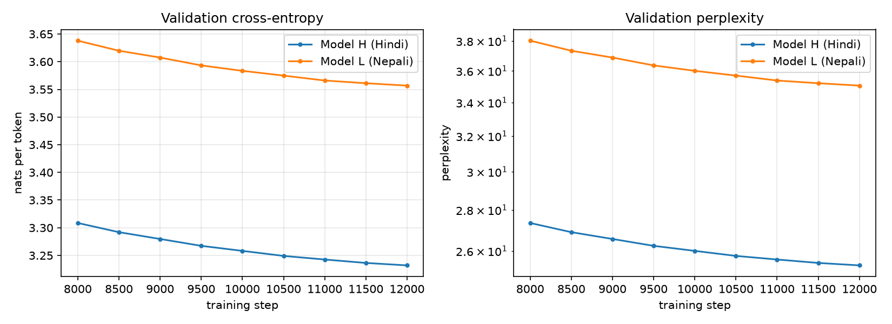
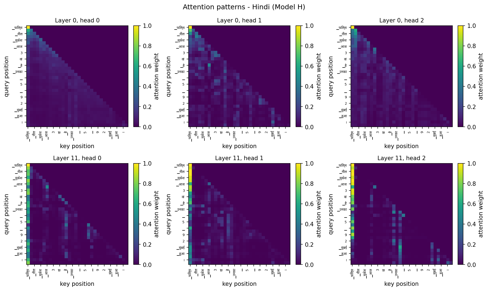
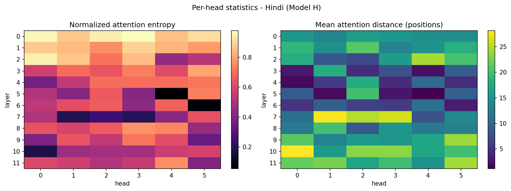
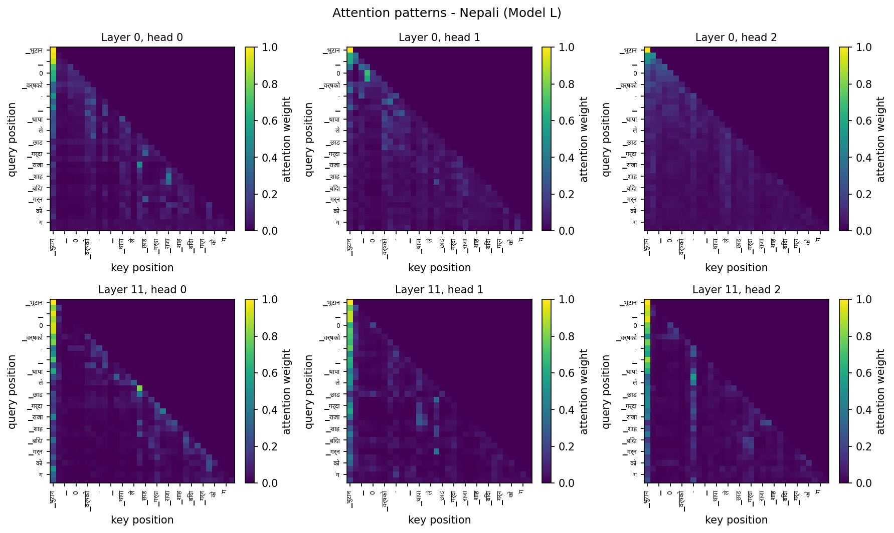
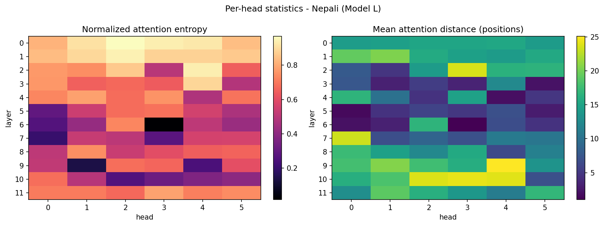

# Phase 2 - Model Implementation, Pretraining, and Evaluation

**Language Models and Agents, Monsoon 2026 - Individual Project**

Two decoder-only Transformers, implemented from primitive PyTorch layers and pretrained independently on the Phase 1 corpora. No weights, data, or vocabulary are shared between them.

---

## 1. Architecture

The forward pass is written out explicitly in `lma/model/transformer.py`: the QKV projection, the reshape into heads, the scaled dot product, the causal mask, the softmax, the head concatenation, and the output projection. Only `nn.Linear`, `nn.Embedding`, `nn.LayerNorm` and `nn.Dropout` are used; there is no `nn.Transformer*` module and no pre-built attention block anywhere in the model.

| | Model H (Hindi) | Model L (Nepali) |
|---|---|---|
| Layers | 12 | 12 |
| Model dimension | 384 | 384 |
| Attention heads | 6 | 6 |
| Feed-forward width | 1536 | 1536 |
| Context length | 512 | 512 |
| Vocabulary | 8000 | 8000 |
| Dropout | 0.1 | 0.1 |
| **Trainable parameters** | **24,562,944** | **24,562,944** |

### Design choices

**Scaling by 1/sqrt(d_k).** Query and key components are approximately unit variance, so their dot product over `d_k` dimensions has variance proportional to `d_k`. Without the scaling, score magnitudes grow with model width, the softmax saturates, and its gradient vanishes - the wider the model, the worse the problem, which is precisely the regime the architecture is meant to support.

**Causal masking.** An additive mask puts `-inf` on future positions *before* the softmax, so they receive exactly zero probability rather than being renormalized afterwards. This is verified empirically rather than assumed: perturbing the token at position `t` leaves every logit at positions `< t` bit-identical, and attention weight on the upper triangle measures exactly 0.0. Both checks run in `scripts/test_model.py`.

**Pre-norm blocks.** Normalization is applied entering each sublayer and the raw residual is added, so the path from input to loss carries no normalization and gradients reach early layers undiminished. Post-norm places a LayerNorm on that path and needs careful warmup to stay stable at this depth.

**Learned absolute positional embeddings.** Chosen for simplicity at a single fixed context length. The cost is that the model cannot run on sequences longer than `block_size` - no embedding exists for those positions - where sinusoidal or rotary encodings would extrapolate.

**Tied input and output embeddings.** One matrix serves as both the token embedding and the output projection, saving `vocab_size x n_embd` = 3.07M parameters, about an eighth of the budget, and tying each token's representation to the vector that predicts it.

---

## 2. Pretraining

AdamW with weight decay applied only to the 2D weight matrices - biases, LayerNorm gains, and embeddings set scale and offset rather than mixing features, and decaying them is a bias with no regularizing benefit. The learning rate warms up linearly and then follows a cosine decay: warmup because Adam's second-moment estimate is unreliable in the first few hundred steps, and cosine because it spends most of the budget at a high rate before annealing smoothly.

| | Model H | Model L |
|---|---|---|
| Training steps | 12,000 | 12,000 |
| Tokens seen | 0.59B | 0.59B |
| Best validation loss | 3.2320 | 3.5568 |
| Wall-clock hours | 15.9 | 15.7 |

Checkpoints carry model weights, optimizer state, scheduler position (the step, from which the schedule is a pure function), the step counter, RNG state for both torch and the batch sampler, and the full configuration. This matters because the training platform stops a session after 12 hours: a run spans several sessions, and an interrupted run resumed from its checkpoint reaches **bit-identical** weights to one that never stopped, which is asserted in the test suite.



---

## 3. Language-modeling metrics

| Metric | Model H (Hindi) | Model L (Nepali) |
|---|---|---|
| Cross-entropy (nats/token) | 3.2152 | 3.5933 |
| **Perplexity** | 24.91 | 36.35 |
| **Bits-per-byte** | 0.5173 | 0.4856 |
| Held-out tokens | 1,638,400 | 1,638,400 |
| Bytes per token | 8.97 | 10.68 |

Perplexity is `exp` of the mean cross-entropy. It is **not** comparable between the two models on its own: a tokenizer that packs more text into each piece faces fewer prediction decisions per sentence, and its per-token loss is spread over more characters. Bits-per-byte removes that advantage by expressing the same total loss per byte of the underlying UTF-8 text - a property of the text rather than of the segmentation.

### The two metrics disagree, and the disagreement is the point

Model H has the better perplexity (24.91 against 36.35) but the **worse** bits-per-byte (0.5173 against 0.4856). This is not a contradiction; it is exactly the effect bits-per-byte exists to expose.

The cause is in the tokenizers. Each Nepali token carries **10.68 bytes** of text against Hindi's **8.97** - 19% more. So a Nepali prediction is a harder problem covering more ground: its per-token loss is higher (3.5933 against 3.2152 nats), but divided across more bytes it comes out lower. The arithmetic is direct: `BPB = cross-entropy / (bytes-per-token x ln 2)`, which reproduces both reported figures to three decimal places.

Which number should be believed depends on the question. **Per token**, Model H predicts its language better, which is what perplexity says and what the larger, cleaner Hindi corpus would predict. **Per byte of text**, Model L compresses marginally better - a result that flatters Nepali's tokenizer rather than its language model, since the same corpus that made Nepali harder to model also gave it longer, more predictable pieces.

The honest reading is that the two models are closer than the perplexity gap suggests, and that neither metric alone settles the comparison. This is the concrete reason the assignment asks for both.

---

## 4. Generation quality

Continuations were generated from held-out prefixes under greedy decoding and temperatures 0.5, 1.0 and 1.5, and scored against the text that actually followed those prefixes in the held-out split.

**Model H (Hindi)**

| Decoding | BLEU-4 | chrF | ROUGE-L | Repetition | Distinct-1 | Distinct-2 |
|---|---|---|---|---|---|---|
| Greedy | 1.07 | 13.57 | 10.27 | 0.563 | 0.131 | 0.288 |
| T = 0.5 | 1.20 | 16.30 | 11.07 | 0.208 | 0.233 | 0.573 |
| T = 1.0 | 0.76 | 18.71 | 9.82 | 0.002 | 0.459 | 0.910 |
| T = 1.5 | 0.28 | 17.81 | 5.66 | 0.000 | 0.645 | 0.990 |

**Model L (Nepali)**

| Decoding | BLEU-4 | chrF | ROUGE-L | Repetition | Distinct-1 | Distinct-2 |
|---|---|---|---|---|---|---|
| Greedy | 0.00 | 13.91 | 3.94 | 0.607 | 0.176 | 0.323 |
| T = 0.5 | 0.00 | 17.25 | 4.58 | 0.174 | 0.375 | 0.693 |
| T = 1.0 | 0.00 | 19.85 | 4.57 | 0.000 | 0.637 | 0.984 |
| T = 1.5 | 0.00 | 19.99 | 2.26 | 0.000 | 0.742 | 0.999 |

### What these metrics can and cannot tell us

BLEU, chrF and ROUGE-L were designed for tasks with a correct answer - translation, summarization - where the reference is *the* right output. Open-ended continuation has no such reference: a fluent, grammatical, entirely sensible continuation that simply differs from what the corpus happened to say next scores near zero. The absolute values here should therefore not be read as quality.

They remain informative **comparatively**. chrF is the most useful of the three for these languages: it scores character n-grams, so two inflections of the same lemma - common in Hindi and Nepali, both morphologically rich - receive partial credit where BLEU's word n-grams give none. BLEU-4 is the least informative, since matching four consecutive words by chance is vanishingly unlikely in open-ended text.

The diversity diagnostics need no reference and are the more honest signal. Repetition rate rises and Distinct-1/2 fall as decoding temperature drops, which is the expected and well-documented failure of greedy decoding: the model collapses onto its most probable continuations and loops.

### Sample continuations

**Model H (Hindi)**

*Greedy*

> 1990 में मुंबई में एक फिल्म निर्देशक के रूप में काम कर रहे थे। उन्होंने 1990 में फिल्म 'दंगल' से बॉलीवुड में कदम रखा था। उन्होंने 1990 में फिल्म 'दंगल' से बॉलीवुड में कदम रखा था।

> लेकर है। दीपिका पादुकोण ने दीपिका पादुकोण को लेकर एक और ट्वीट किया है। दीपिका पादुकोण ने लिखा है कि दीपिका पादुकोण ने दीपिका पादुकोण को लेकर एक और ट्वीट किया है।

*T = 1.0*

> बॉलीवुड में पहली बार मुख्य अभिनेता के रूप में दिखाई दिए थे। उनके पिता की दोस्ती सतलुज पहाड़ी और भारतीय / अगम ऑफ सी प्रीमियम फिल्म थी। उनकी दोस्त सुदर्शन अपनी पत्नी के साथ शादी के लिए तैयार थे।

> खींचते हुए नजर आईं। जियो टीवी के विला कंपनी जियो टीवी से बातचीत के दौरान अतिया लखनिए ने बताया कि अक्षय कुमार वही काम कर रहे हैं, जिनसे उन्होंने खूब प्यार किया है।


**Model L (Nepali)**

*Greedy*

> मा पुगे। 2007 सालतिर उनी दरबारमा प्रवेश गरे। 2007 सालतिर उनी दरबारमा प्रवेश गरे। 2007 सालतिर उनी दरबारमा प्रवेश गरे।

> बेरसम्म पनि हातखुट्टामा हात राखेर हातखुट्टामा हात राखेर हातखुट्टामा हात राखेर हातखुट्टामा हात राखेर

*T = 1.0*

> मा बस्दथे र 35 बर्षको भए पिता सुले शरदचन्द्र शाहलाई बिदाइ गर्नुभयो।' राजा राम शाह आइतबार बसपार्कबाट लण्डन पुगे र राष्ट्रपति बाइस असोज 24 गते उनलाई सिनजियो लगायतको गाडीमा पठाए।

> दिनमा हामी डिनर देउ भरियासँग हाँसघाम लागिरहेका थियौं। हामी त उनीहरुको निदाएको अनुहार पनि टक्क टक्क वक्क हेरिरह्यौं। एउटा दुरुस्त फेला पार्यौं।


---

## 5. Attention analysis

Two summaries per head, computed only over positions a causal model may attend to. **Entropy** measures how spread a head's attention is; because a head at position `t` can see only `t + 1` positions, raw entropy grows along the sequence for structural reasons, so the normalized form (divided by `log(t + 1)`) is what should be compared across heads. **Mean attention distance** is how far back a head looks on average, weighted by attention mass.

**Model H (Hindi)** - head types: 10 local, 48 long-range, 14 diffuse

| Layer | Mean entropy | Mean attention distance |
|---|---|---|
| 0 | 2.999 | 14.95 |
| 1 | 2.782 | 16.83 |
| 2 | 2.361 | 15.78 |
| 3 | 2.161 | 7.51 |
| 4 | 2.001 | 7.54 |
| 5 | 1.490 | 7.37 |
| 6 | 1.602 | 6.86 |
| 7 | 1.241 | 18.71 |
| 8 | 2.125 | 13.55 |
| 9 | 1.840 | 17.79 |
| 10 | 1.572 | 21.27 |
| 11 | 1.909 | 20.08 |

**Model L (Nepali)** - head types: 15 local, 42 long-range, 15 diffuse

| Layer | Mean entropy | Mean attention distance |
|---|---|---|
| 0 | 2.958 | 14.80 |
| 1 | 2.911 | 16.67 |
| 2 | 2.458 | 13.92 |
| 3 | 2.190 | 5.71 |
| 4 | 2.264 | 8.83 |
| 5 | 1.713 | 4.48 |
| 6 | 1.271 | 5.73 |
| 7 | 1.432 | 11.22 |
| 8 | 2.057 | 13.00 |
| 9 | 1.630 | 18.44 |
| 10 | 1.443 | 18.89 |
| 11 | 2.406 | 15.00 |

### What the heads learned

Both models show the same three-stage structure, which is worth stating because nothing in the architecture or the training objective asks for it - it emerged from the data.

**Early layers (0-2) attend broadly.** Entropy is highest here (about 3.0 nats) and mean distance is 14-17 positions. These heads are not selecting particular tokens; they are mixing information across the whole visible context, which is what a representation still close to raw embeddings can usefully do.

**Middle layers (3-6) go local and sharp.** Mean distance collapses to 6.9-7.5 positions in Model H and 4.5-8.8 in Model L, while entropy falls to its minimum (1.24 at layer 7 for Hindi, 1.27 at layer 6 for Nepali). These are the positional heads that most decoder-only models learn early: they attend to the previous token or two, and they are the mechanism behind local syntactic agreement - in these languages, matching a verb to its subject or a postposition to the noun it governs.

**Late layers (7-11) reach furthest.** Mean distance rises again to 18-21 positions while entropy stays low, which is the signature of content-based rather than positional attention: a head that looks far away *and* concentrates its mass is selecting a specific earlier token, not averaging over a neighbourhood.

**The heatmaps show something the tables cannot.** In the late layers of both models, nearly every query position puts substantial mass on the very first token, producing the bright left-hand column visible in the layer-11 panels. This is the *attention sink* reported in the literature on trained Transformers: softmax forces each row to sum to one, so a head with nothing informative to attend to must still place its mass somewhere, and the first position - visible from every query and carrying little content - becomes the default. It inflates the mean attention distance in late layers, which is worth knowing when reading those numbers: part of the rise from 7 to 21 positions is heads genuinely reaching back, and part is this sink.

**Where the two models differ.** Model H has more long-range heads (48 against 42) and fewer local ones (10 against 15), and its late layers reach further - 21.3 positions at layer 10 against Nepali's 18.9. The natural reading is that the model with more training data spent proportionally less of its capacity on local structure and more on long-range dependencies, having already learned the local patterns from a larger sample. This is consistent with the perplexity gap but does not prove the causal link: with one run per language, the difference could also reflect the ordinary variation between two training runs. A stronger claim would need several seeds per language, which the compute budget did not allow.









---

## 6. Reproduction

```bash
# Component tests - causality, shapes, resume, and the metrics
python scripts/test_model.py

# Pretrain (notebooks/phase2_pretrain.ipynb runs this on a GPU host)
# then evaluate each trained checkpoint:
python scripts/evaluate_model.py --language hi \
    --checkpoint hindi/checkpoints/checkpoint_best.pt \
    --data-dir <tokenized-data> \
    --tokenizer hindi/tokenizer/hi_unigram_8000.model

# Regenerate this report
python scripts/make_phase2_report.py
```
