# Phase 3 - Reasoning Finetuning, Attention Analysis, and Final Report

**Language Models and Agents, Monsoon 2026 - Individual Project**

Two independently pretrained decoder-only Transformers, each finetuned on a synthetic
comparative-reasoning corpus generated in its own language. No data, vocabulary, or
weights are shared between them at any stage. Every reasoning number below is computed
by `scripts/evaluate_reasoning.py` from the published checkpoints linked in the README.

---

## Project at a glance

This report consolidates the project. Phases 1 and 2 are reported in full in
[`phase1_report.md`](phase1_report.md) and [`phase2_report.md`](phase2_report.md);
the results that carry through to the final comparison are collected here.

| Phase | Result | Model H (Hindi) | Model L (Nepali) |
|---|---|---:|---:|
| 1 | Training tokens | 580,162,728 | 612,476,098 |
| 1 | Manual share of training tokens | 21.6% | 59.8% |
| 1 | Tokenizer fertility (unigram, 8,000 pieces) | 1.453 | 1.692 |
| 2 | Trainable parameters | 24,562,944 | 24,562,944 |
| 2 | Pretraining tokens seen | 590,000,000 | 590,000,000 |
| 2 | Validation perplexity | 24.91 | 36.35 |
| 2 | Bits-per-byte | 0.5173 | 0.4856 |
| 2 | chrF, greedy / T = 1.0 | 13.57 / 18.71 | 13.91 / 19.85 |
| 2 | Distinct-2, greedy / T = 1.0 | 0.288 / 0.910 | 0.323 / 0.984 |
| 3 | Reasoning exact match, pretrained → finetuned | 4.60% → 99.65% | 0.25% → 99.85% |
| 3 | Three-hop (4-entity) chains, finetuned | 99.0% | 99.7% |

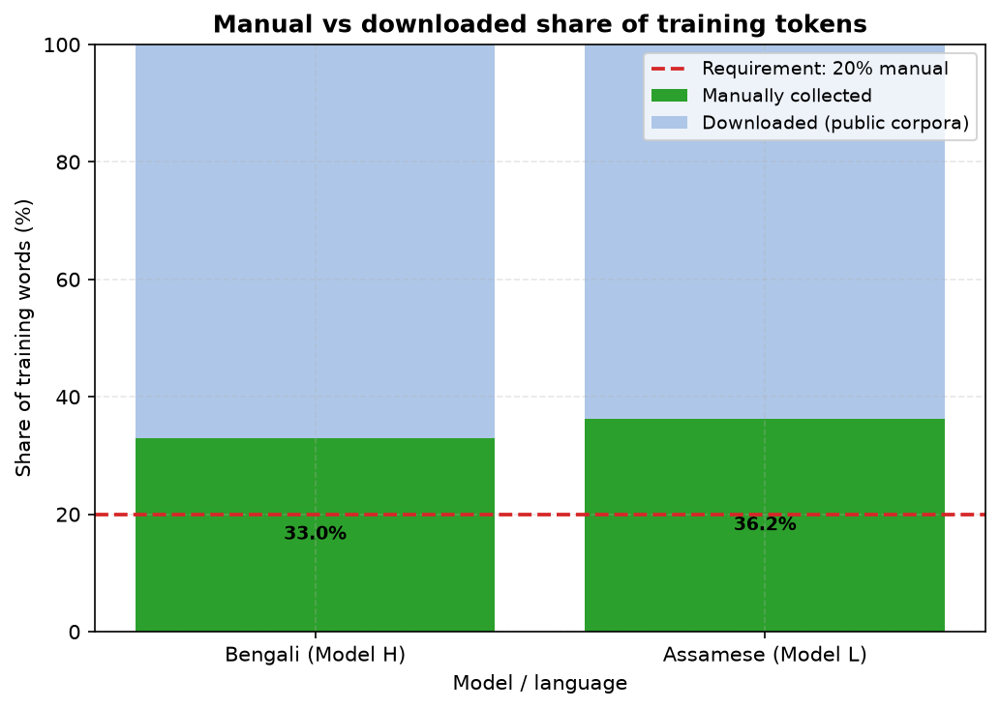

*Phase 1: manual versus downloaded share of each corpus.*

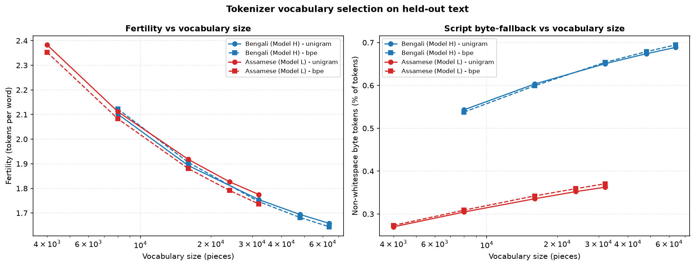

*Phase 1: the vocabulary sweep behind the 8,000-piece tokenizers.*

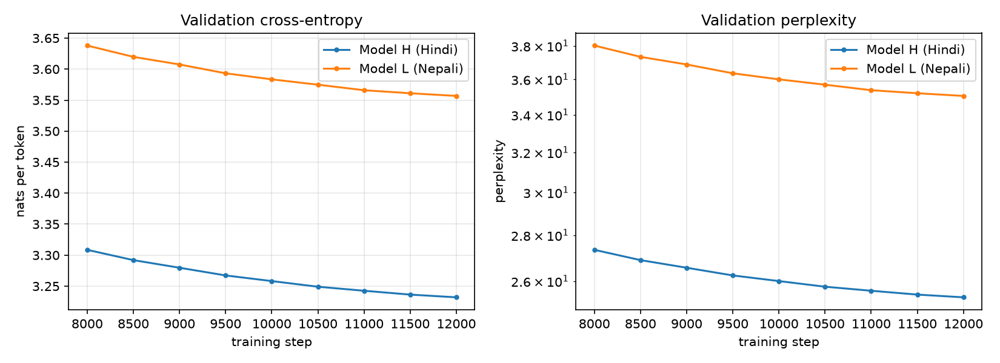

*Phase 2: pretraining validation loss and perplexity.*

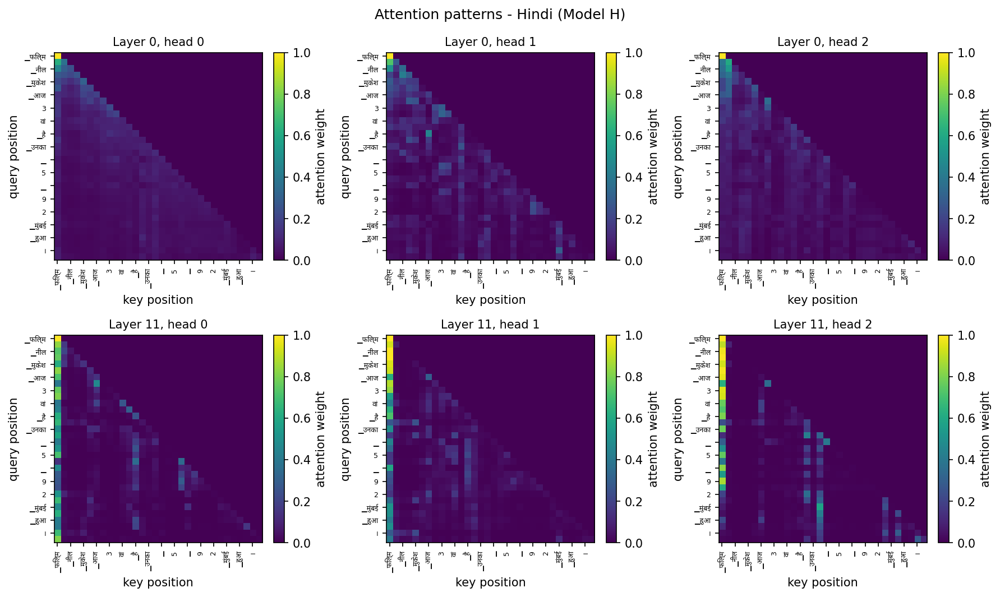

*Phase 2: Model H attention heatmaps on held-out text.*

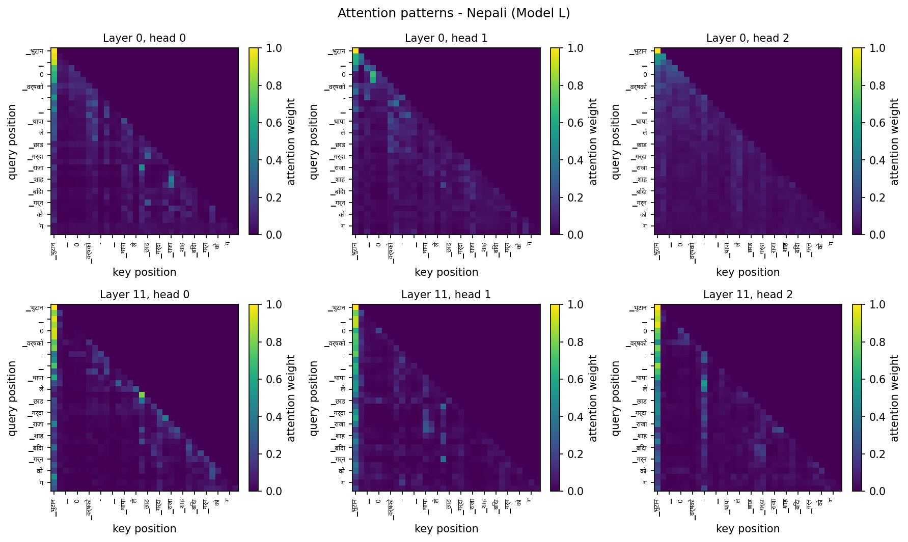

*Phase 2: Model L attention heatmaps on held-out text.*

---

## 1. The synthetic reasoning dataset

Generated programmatically rather than downloaded, so every ground-truth
label is known by construction and the corpus is reproducible from a seed.
The task states a chain of pairwise comparisons and asks for the extreme
element, which requires chaining the inequalities rather than matching a
single sentence.

| Property | Model H | Model L |
|---|---|---|
| Total examples | 20,000 | 20,000 |
| Train | 16,000 | 16,000 |
| Validation | 2,000 | 2,000 |
| Test | 2,000 | 2,000 |
| Unique prompts | 20,000 | 20,000 |
| Entity pool | 42 | 33 |
| Comparable dimensions | 4 | 4 |
| Chain lengths | 2, 3, 4 | 2, 3, 4 |

### Leakage control

Three mechanisms, each covering what the others do not. **Chain signatures**
- the unordered entity set plus the dimension - are partitioned across
splits, so no evaluation example re-tests a comparison any training example
covered. A minority of names appear **only in evaluation premises**, testing
that an unfamiliar participant does not derail the comparison. Within those
constraints, assignment is by salted content hash, as in Phase 1.

| Check | Model H | Model L |
|---|---|---|
| Chain-signature overlap (train vs eval) | 0 | 0 |
| Prompt overlap (train vs eval) | 0 | 0 |
| Duplicate prompts | 0 | 0 |
| Evaluation answers that are distractors | 0 | 0 |

**A rejected earlier design, recorded because it is the obvious one.**
Reserving names for the *answer* position - so every test answer was a token
absent from all training targets - makes the task unanswerable rather than
hard. Measured during development on a small, randomly initialized model
trained on this task: 0.0000 exact match on held-out-answer
examples against 0.2600 on examples whose prompts were equally unseen but
whose answers came from the training vocabulary. The evaluation set, not the
model, was the failure.

---

## 2. Finetuning

Each model starts from its own Phase 2 checkpoint, keeps its own tokenizer
and vocabulary, and trains only on its own language's data. Loss is computed
on the **answer span only**: the prompt states premises the model is
conditioned on, not asked to produce, so every prompt position is masked out
of the objective.

Every hyperparameter is listed below. They are committed as
`<language>/configs/finetune.yaml`, and `scripts/test_reasoning.py` asserts
that file matches the configuration recorded by the run itself, so the
documentation cannot drift from what produced the results.

| Hyperparameter | Model H | Model L |
|---|---|---|
| Starting checkpoint | own Phase 2 model, step 12,000 | own Phase 2 model, step 12,000 |
| Tokenizer / vocabulary | own Phase 1 unigram, 8,000 pieces, frozen | own Phase 1 unigram, 8,000 pieces, frozen |
| Trainable parameters | 24,562,944 | 24,562,944 |
| Training examples | 16,000 | 16,000 |
| Epochs | 3 | 3 |
| Batch size (examples) | 32 | 32 |
| Optimizer steps | 1,500 | 1,500 |
| Optimizer | AdamW, betas (0.9, 0.95) | AdamW, betas (0.9, 0.95) |
| Peak learning rate | 5.0e-05 | 5.0e-05 |
| Minimum learning rate | 5.0e-06 | 5.0e-06 |
| Schedule | linear warmup 100 steps, cosine decay | linear warmup 100 steps, cosine decay |
| Weight decay | 0.1 (2D weights only) | 0.1 (2D weights only) |
| Gradient clipping | norm 1.0 | norm 1.0 |
| Mixed precision | yes | yes |
| Max sequence length | 64 tokens (longer examples dropped) | 64 tokens (longer examples dropped) |
| Loss | answer token + EOS only; prompt masked | answer token + EOS only; prompt masked |
| Seed | 20260812 | 20260812 |
| Checkpoint reported | step 1,400 (val loss 0.0046) | step 1,500 (val loss 0.0024) |
| Wall-clock | 1.9 min | 2.1 min |

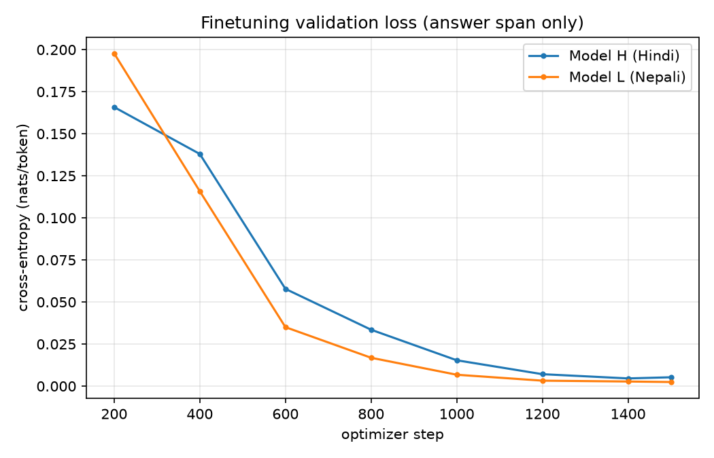

---

## 3. Reasoning results

Exact match on the held-out test split. Both checkpoints are scored the same
way - greedy argmax at the position following the answer prefix, no sampling
- so the comparison isolates the weights.

| Metric | Model H | Model L |
|---|---|---|
| Pretrained exact match | 0.0460 | 0.0025 |
| Finetuned exact match | 0.9965 | 0.9985 |
| Improvement | +0.9505 | +0.9960 |
| Chance (aggregate) | 0.3483 | 0.3381 |
| Pretrained constrained accuracy | 0.2600 | 0.2180 |
| Finetuned constrained accuracy | 0.9965 | 0.9985 |
| Test examples | 2,000 | 2,000 |

### Accuracy against chance, per chain length

Chance differs sharply by chain length - one in two for a two-entity
comparison against one in four for a four-entity chain - so a single blended
baseline is misleading. The per-length comparison is the honest one.

**Model H**

| Entities | Accuracy | Chance | Margin | n |
|---|---:|---:|---:|---:|
| 2 | 1.000 | 0.500 | +0.500 | 546 |
| 3 | 1.000 | 0.333 | +0.667 | 720 |
| 4 | 0.990 | 0.250 | +0.740 | 734 |

**Model L**

| Entities | Accuracy | Chance | Margin | n |
|---|---:|---:|---:|---:|
| 2 | 1.000 | 0.500 | +0.500 | 453 |
| 3 | 0.999 | 0.333 | +0.665 | 755 |
| 4 | 0.997 | 0.250 | +0.747 | 792 |

### Error analysis

Mistakes are sorted into three kinds, because they call for different
explanations. **Off-chain** means the prediction was not any entity in the
premises - the model did not identify the answer as a choice among the named
entities at all. **Inverted** means it named the entity at the opposite end
of the ordering, which suggests it tracked the comparison but mishandled the
question's polarity. **Wrong entity** is everything else.

Counts cover every one of the test examples. (An earlier revision of this
analysis read only a 40-prediction sample, and so reported an all-zero
profile for models whose few mistakes fell outside it.)

| Failure mode | Model H pretrained | Model H finetuned | Model L pretrained | Model L finetuned |
|---|---:|---:|---:|---:|
| All errors | 1,908 | 7 | 1,995 | 3 |
| Off-chain | 1,491 (78.1%) | 0 (0.0%) | 1,918 (96.1%) | 0 (0.0%) |
| Wrong entity | 316 (16.6%) | 7 (100.0%) | 73 (3.7%) | 3 (100.0%) |
| Inverted polarity | 101 (5.3%) | 0 (0.0%) | 4 (0.2%) | 0 (0.0%) |

### Qualitative successes and failures

**Model H (Hindi)**

*Before finetuning.* Across the first 60 recorded pretrained errors, the most frequent predictions were `▁` (40), `-` (10), `सचिन` (2). `▁` is SentencePiece's bare word-boundary piece: the pretrained model treats the answer prefix as the middle of running text and predicts that a new word begins, rather than naming anyone - which is why off-chain errors dominate its profile.

*Finetuned successes* (longest chains first):

| Prompt | Answer | Entities |
|---|---|---:|
| किरण नरेश से अमीर है। सूरज मोहन से अमीर है। नरेश सूरज से अमीर है। सबसे अमीर कौन है? उत्तर - | किरण | 4 |
| अशोक रमेश से अमीर है। रमेश विकास से अमीर है। सुरेश अशोक से अमीर है। सबसे गरीब कौन है? उत्तर - | विकास | 4 |
| संजय राधा से लंबा है। रमेश संजय से लंबा है। गीता रमेश से लंबा है। सबसे लंबा कौन है? उत्तर - | गीता | 4 |

*Every finetuned failure* (7 of 2,000):

| Prompt | Expected | Predicted | Entities |
|---|---|---|---:|
| अनिल अशोक से लंबा है। दीपक अनिल से लंबा है। अशोक सूरज से लंबा है। सबसे छोटा कौन है? उत्तर - | सूरज | अशोक | 4 |
| कृष्ण मोहन से तेज़ है। विनोद विकास से तेज़ है। मोहन विनोद से तेज़ है। सबसे तेज़ कौन है? उत्तर - | कृष्ण | विनोद | 4 |
| संजय कृष्ण से लंबा है। गीता संजय से लंबा है। कृष्ण महेश से लंबा है। सबसे छोटा कौन है? उत्तर - | महेश | कृष्ण | 4 |
| पवन सूरज से बड़ा है। राहुल पवन से बड़ा है। सचिन राहुल से बड़ा है। सबसे बड़ा कौन है? उत्तर - | सचिन | पवन | 4 |
| सुरेश कृष्ण से लंबा है। सचिन सीता से लंबा है। सीता सुरेश से लंबा है। सबसे छोटा कौन है? उत्तर - | कृष्ण | सीता | 4 |
| अशोक विजय से तेज़ है। दिनेश विनोद से तेज़ है। विजय दिनेश से तेज़ है। सबसे तेज़ कौन है? उत्तर - | अशोक | दिनेश | 4 |
| गणेश विनोद से बड़ा है। सचिन गणेश से बड़ा है। विनोद अर्जुन से बड़ा है। सबसे बड़ा कौन है? उत्तर - | सचिन | गणेश | 4 |

7 of the 7 failures are four-entity, three-hop chains, the hardest length; none are off-chain, so the model always answered with a named participant.

**Model L (Nepali)**

*Before finetuning.* Across the first 60 recorded pretrained errors, the most frequent predictions were `▁` (59), `निर्मला` (1). `▁` is SentencePiece's bare word-boundary piece: the pretrained model treats the answer prefix as the middle of running text and predicts that a new word begins, rather than naming anyone - which is why off-chain errors dominate its profile.

*Finetuned successes* (longest chains first):

| Prompt | Answer | Entities |
|---|---|---:|
| किरण विजयभन्दा धनी छ। विजय प्रकाशभन्दा धनी छ। प्रकाश सन्तोषभन्दा धनी छ। सबैभन्दा धनी को हो? उत्तर - | किरण | 4 |
| गणेश कमलाभन्दा छिटो छ। हरि रमेशभन्दा छिटो छ। रमेश गणेशभन्दा छिटो छ। सबैभन्दा छिटो को हो? उत्तर - | हरि | 4 |
| किरण निर्मलाभन्दा धनी छ। निर्मला विजयभन्दा धनी छ। विजय रामभन्दा धनी छ। सबैभन्दा गरिब को हो? उत्तर - | राम | 4 |

*Every finetuned failure* (3 of 2,000):

| Prompt | Expected | Predicted | Entities |
|---|---|---|---:|
| कृष्ण बिकासभन्दा धनी छ। विकास कृष्णभन्दा धनी छ। सबैभन्दा धनी को हो? उत्तर - | विकास | कृष्ण | 3 |
| महेश श्यामभन्दा धनी छ। यादव शर्माभन्दा धनी छ। शर्मा महेशभन्दा धनी छ। सबैभन्दा गरिब को हो? उत्तर - | श्याम | शर्मा | 4 |
| कुमार बिकासभन्दा जेठो छ। विकास कुमारभन्दा जेठो छ। बिकास कृष्णभन्दा जेठो छ। सबैभन्दा जेठो को हो? उत्तर - | विकास | कुमार | 4 |

2 of the 3 failures are four-entity, three-hop chains, the hardest length; none are off-chain, so the model always answered with a named participant.

**A flaw in the entity pool, found by reading these failures.** 2 of the 3 errors involve `बिकास` / `विकास`: names one character apart that the generator treats as different people, but which a reader would take to be spelling variants of one name. A premise pair comparing them is contradictory to a human, so these examples are ill-posed rather than hard. The pools were vetted for single-token encoding but not for near-homographs; dropping one variant from each pair is the fix.

---

## 4. Attention, before and after finetuning

Both checkpoints read the same 200 held-out reasoning prompts, so any
difference in where the heads look is attributable to finetuning. Each head's
entropy and mean look-back distance are averaged over those prompts *before*
heads are classified, because a single prompt is a sample of one. The heatmaps
at the end of this section show layers 0 and 11 for one prompt, as an
illustration only.

### Local versus long-range attention

| Head type | Model H pretrained | Model H finetuned | Model L pretrained | Model L finetuned |
|---|---:|---:|---:|---:|
| Local (mean distance < 5) | 34 | 45 | 29 | 36 |
| Long-range | 32 | 23 | 36 | 29 |
| Diffuse (normalized entropy > 0.8) | 6 | 4 | 7 | 7 |

Mean look-back distance by layer, in positions:

| Layer | Model H pretrained | Model H finetuned | Model L pretrained | Model L finetuned |
|---|---:|---:|---:|---:|
| 0 | 5.35 | 5.04 | 5.59 | 5.56 |
| 1 | 5.76 | 5.22 | 6.44 | 6.24 |
| 2 | 6.01 | 5.04 | 6.11 | 5.33 |
| 3 | 3.95 | 3.57 | 3.76 | 3.26 |
| 4 | 4.03 | 3.24 | 4.75 | 3.85 |
| 5 | 3.79 | 2.69 | 3.14 | 2.46 |
| 6 | 3.65 | 3.03 | 3.41 | 2.71 |
| 7 | 5.76 | 4.75 | 4.87 | 4.76 |
| 8 | 4.85 | 3.64 | 6.15 | 4.61 |
| 9 | 6.00 | 5.46 | 7.27 | 7.26 |
| 10 | 6.46 | 6.04 | 6.51 | 6.91 |
| 11 | 5.70 | 5.87 | 6.23 | 6.32 |

**Model H:** local heads 34 → 45, long-range heads 32 → 23. Mean distance fell in 11 of 12 layers; across layers 3-8 it went from 4.34 to 3.49 positions, and across layers 9-11 from 6.06 to 5.79.

**Model L:** local heads 29 → 36, long-range heads 36 → 29. Mean distance fell in 10 of 12 layers; across layers 3-8 it went from 4.35 to 3.61 positions, and across layers 9-11 from 6.67 to 6.83.

In both models finetuning made the middle of the network more local. That
fits the task: each premise is a short clause, and relating a name to the
comparative that follows it is work done over a few positions. It does not
mean the models stopped reaching back - the next measurement shows their
late layers doing exactly that, but selectively.

### Head specialization: attention on the correct answer

The last prompt position is where the answer is predicted, so what it attends
to is the most direct view of how the answer is reached. For each layer and
each prompt, the measurement takes the head putting the most attention on the
correct entity's token; as the baseline, it takes whichever head attends most
to each occurrence of the *other* named entities. Premises are shuffled, so the answer sits at a
different position in every prompt: a head that finds it is not doing so by
position.

| Measure | Model H | Model L |
|---|---|---|
| Pretrained: most answer-focused layer | 0.24 at layer 10 (any head on another entity: 0.20) | 0.23 at layer 9 (any head on another entity: 0.18) |
| Finetuned: most answer-focused layer | 0.98 at layer 10 (any head on another entity: 0.20) | 0.98 at layer 10 (any head on another entity: 0.42) |
| Finetuned layers with a head at ≥ 0.80 on the answer | 9, 10, 11 | 9, 10, 11 |

Before finetuning, no layer singles out the answer: its most answer-focused
head gives the correct entity about what it gives any other named entity.
After finetuning, both models - independently, each in its own language -
have late layers containing a head that puts almost all of the answer
position's attention on the correct entity - and since a head's attention sums
to one, that leaves it almost nothing for the distractors.
That is a content-based head created by finetuning, and it is the clearest
evidence in this project of head specialization on comparative-reasoning
prompts. It shows where the answer is *read out*; it does not show where the
ordering is worked out, which happens in earlier layers this measurement
does not isolate.

#### Model H (Hindi) figures

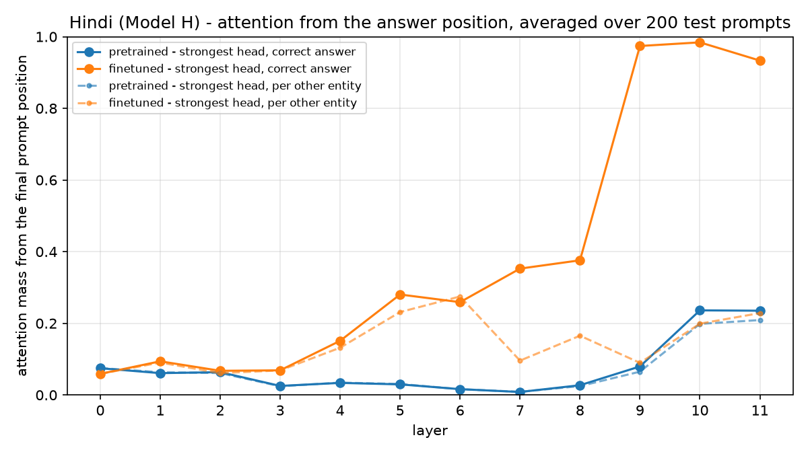

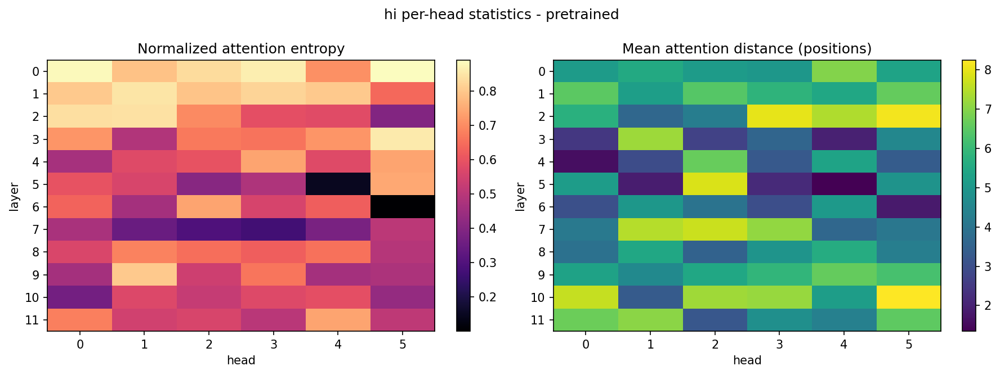

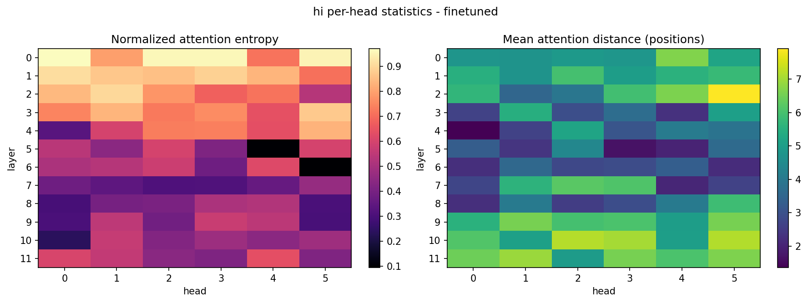

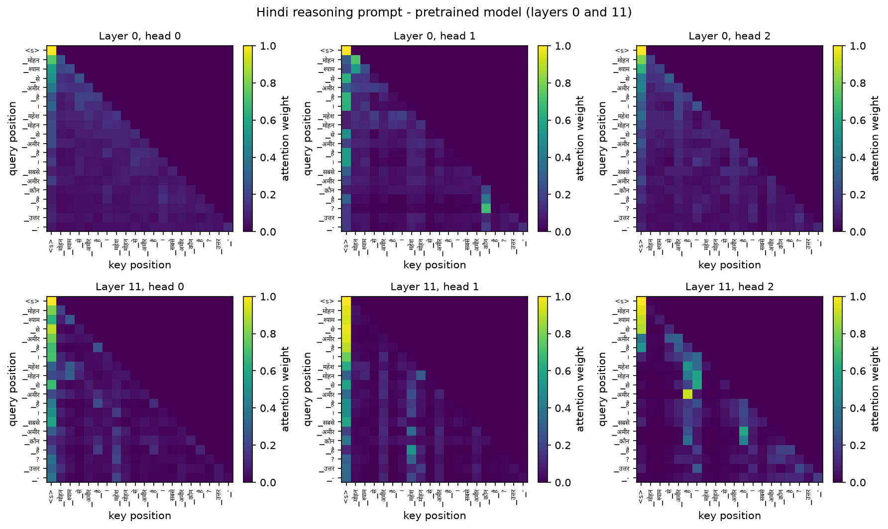

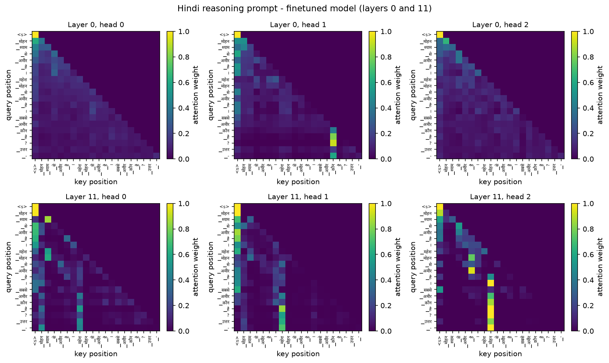

#### Model L (Nepali) figures

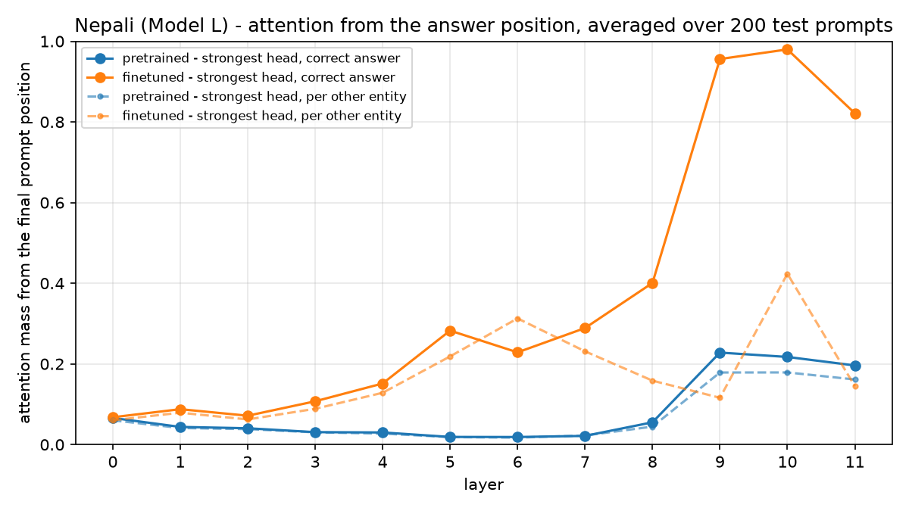

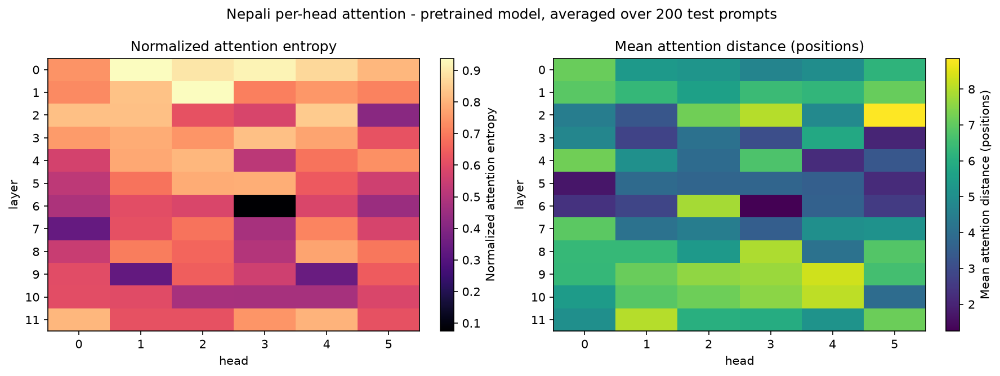

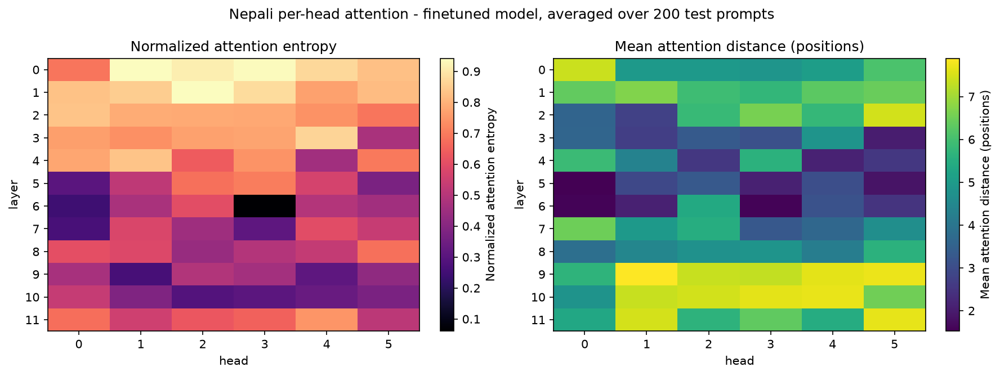

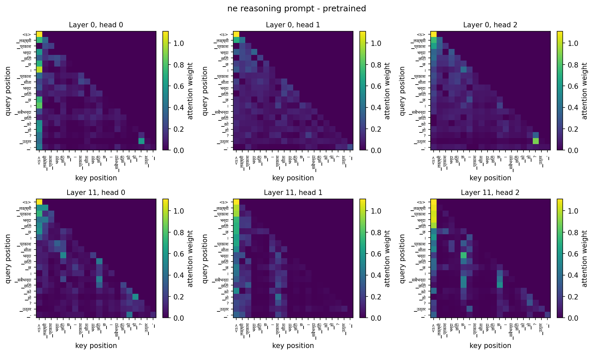

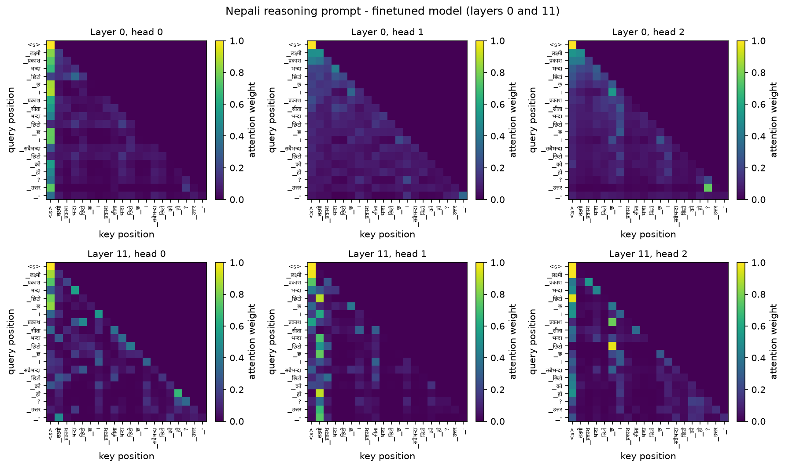

---

## 5. The two resource tiers compared

### 1. How did data scale and quality differ between Model H and Model L?

| | Model H (Hindi) | Model L (Nepali) |
|---|---:|---:|
| Documents kept | 940,329 | 774,236 |
| Share of documents surviving cleaning | 93.7% | 88.0% |
| Rejected as the wrong language | 758 | 9,723 |
| Rejected for low Devanagari share | 17,453 | 31,028 |
| Training tokens | 580,162,728 | 612,476,098 |
| Words in the corpus | 392,120,217 | 364,030,498 |
| Manual share of training tokens | 21.6% | 59.8% |
| Corpus sources | 7 | 3 |
| Largest source, share of words | `indiccorp_hi` 80.9% | `manual_mixed_bulk_ne` 51.7% |
| Tokenizer fertility (tokens/word) | 1.453 | 1.692 |
| Words encoded as a single token | 74.9% | 59.0% |
| Validation perplexity (Phase 2) | 24.91 | 36.35 |
| Bits-per-byte (Phase 2) | 0.5173 | 0.4856 |

**Scale was not the difference.** Model L's corpus finished with 612,476,098 training tokens against Model H's 580,162,728 (+5.6%), and both clear the 500M target. Counted in words the order reverses - 364,030,498 against 392,120,217 - because Nepali text costs more tokens per word.

**Cleanliness and availability were.** 88.0% of Nepali documents survived cleaning against 93.7% of Hindi, and 9,723 Nepali documents were rejected as the wrong language against 758: 13 times the contamination pressure. Model L's corpus is 60% manually collected against 22%; both exceed the 20% requirement, but Nepali's share reflects how little clean public Nepali text there was to download.

The number of sources is a weak proxy for breadth and is not used as evidence: Model H's largest source, `indiccorp_hi`, supplies 81% of its words against 52% for Model L's `manual_mixed_bulk_ne`, but it is itself a crawl of many news and web sites.

**The tokenizers differ sharply.** At the same 8,000-piece vocabulary, Nepali needs 1.692 tokens per word against 1.453, and encodes 59% of words as a single piece against 75%.

### 2. How do language-modeling and reasoning results compare across the two tiers?

**Language modeling (Phase 2).** Model H has the better perplexity (24.91 against 36.35) but Model L the better bits-per-byte (0.4856 against 0.5173). Each Nepali token carries 10.68 bytes of text against 8.97, so a per-token loss is spread over different amounts of text: perplexity is not comparable across tokenizers, and bits-per-byte corrects for it. The models are closer than perplexity alone suggests.

**Reasoning (Phase 3).** Finetuning took Model H from 4.60% to 99.65% exact match and Model L from 0.25% to 99.85%. The two finish within 0.20 percentage points of each other and within 0.35 points of ceiling, and Model L scores marginally higher.

**The reasoning task did not separate the tiers, and that is the result.** Each language's corpus uses one comparative sentence frame and one question frame, instantiated over 4 attributes, 3 chain lengths and 2 question polarities, with single-token answers. That regularity is learnable to near-ceiling from 16,000 examples whichever pretrained model starts the finetuning, so the task cannot resolve a difference between the two.

Two things follow. The tier difference established in Phase 2 is real but lives in open-ended language modeling, which is what those metrics measure. And a reasoning benchmark that would discriminate needs to be harder than this one: longer chains, premises irrelevant to the question, or comparisons stated across intervening text.

### 3. What tokenizer and corpus factors most affected the lower-resource model?

**Tokenizer fertility, first.** A 512-token context holds about 303 Nepali words against 352 Hindi ones, and the 590M-token pretraining budget covered about 349M Nepali words against 406M Hindi ones - 14% less language for the same compute. The effect persists in Phase 3: the Nepali reasoning prompts average 24.0 tokens against 22.4 for Hindi.

**Corpus cleanliness and availability, second.** Lower cleaning survival and a 13-fold higher wrong-language rejection count mark noisier source material, and the 60% manual share shows how little of it could simply be downloaded.

Both plausibly contribute to Model L's higher Phase 2 perplexity. Neither limited reasoning finetuning, which saturated for both models.

### 4. What evidence explains the observed differences?

**For the language-modeling gap:** the bytes-per-token figures above, which reproduce the perplexity/bits-per-byte disagreement arithmetically (bits-per-byte = cross-entropy / (bytes per token × ln 2)), together with the fertility and cleaning figures in question 1.

**Before finetuning, the tier does show.** Neither pretrained model can do the task - 4.6% and 0.25% exact match, below chance - but they fail differently. When Model H is wrong it still names a participant from the premises 22% of the time; Model L does so 4% of the time. Otherwise both mostly predict a bare word boundary, continuing the answer prefix as running text. The model pretrained on the cleaner corpus came closer to treating the prefix as a slot for a name - suggestive, not conclusive, with one model per language on a task neither was trained for.

**After finetuning, the mechanism is the same in both.** Each model has late layers with a head putting at least 0.80 of the answer position's attention on the correct entity - layers 9, 10, 11 in Model H and 9, 10, 11 in Model L (section 4). The two tiers converge on the same solution in the same part of the network.

**Two caveats, stated plainly.** There is one training run per language, so a difference between the models could reflect ordinary between-run variation rather than the resource tier; several seeds per language would be needed to establish it. And near-ceiling accuracy on a synthetic, templated task is evidence that the models learned this task's regularities, not evidence of general reasoning ability.

### Limitations

- **The reasoning task saturates.** Both models exceed 99.6% exact match, so it cannot rank the tiers.
- **Limited template variety.** One comparative frame and one question frame per language; no equality or numeric comparisons.
- **Spelling-variant names in the Nepali pool** (`बिकास` / `विकास`), which read as one name to a human; see the failures in section 3.
- **The attention evidence is correlational.** Statistics averaged over 200 prompts show where finetuned models attend, not that this attention causes the answer; ablating the specialized heads would test that.
- **One run per language**, for both pretraining and finetuning.

---

## 6. Bonus ablation: no positional embeddings

The optional ablation retrains one language with the positional-embedding table
removed (`ModelConfig(use_positional_embeddings=False)`, 196,608 fewer parameters)
and every other setting unchanged. `scripts/test_reasoning.py` pins down what that
removes: one ablated attention layer sees the tokens before a position as an
unordered set, but two layers can recover their order, because under the causal
mask each position's state summarizes a prefix of a different length. The ablation
therefore measures how much of the positional signal a 12-layer stack recovers on
its own - it does not test a model that is blind to word order.

| Model | Variant | Steps | Perplexity | Bits-per-byte |
|---|---|---:|---:|---:|
| Model H (Hindi) | standard | 12,000 | 24.91 | 0.5173 |
| Model H (Hindi) | no positional embeddings | 12,000 | 25.83 | 0.5231 |

The full comparison - validation loss at matched steps, every generation metric, the
attention analysis, and what breaks without position information - is in
[`bonus_ablation.md`](bonus_ablation.md), generated by `scripts/make_ablation_report.py`.

---

## 7. Reproduction

The checkpoints are on Google Drive (links in the README): the Phase 2 models at
`Phase2-Checkpoints/<language>/checkpoint_best.pt` and the finetuned models at
`Phase3-Finetuned/<code>_finetuned_best.pt`.

```bash
# Component tests - templates, leakage, masking, resume, scoring, attention, ablation
python scripts/test_reasoning.py

# Generate both reasoning datasets (seeded, so this reproduces them byte for byte)
python scripts/generate_reasoning_data.py --language hi
python scripts/generate_reasoning_data.py --language ne

# Finetune from the Phase 2 checkpoint; reads hindi/configs/finetune.yaml
# (notebooks/phase3_finetune.ipynb runs the same code on a Kaggle GPU)
python scripts/finetune_reasoning.py --language hi \
    --checkpoint Phase2-Checkpoints/hindi/checkpoint_best.pt \
    --tokenizer hindi/tokenizer/hi_unigram_8000.model

# Score pretrained against finetuned and analyse attention (a CPU is enough)
python scripts/evaluate_reasoning.py --language hi \
    --pretrained Phase2-Checkpoints/hindi/checkpoint_best.pt \
    --finetuned Phase3-Finetuned/hi_finetuned_best.pt \
    --tokenizer hindi/tokenizer/hi_unigram_8000.model

# Check every deliverable, then regenerate this report
python scripts/check_phase3.py
python scripts/make_phase3_report.py
```
